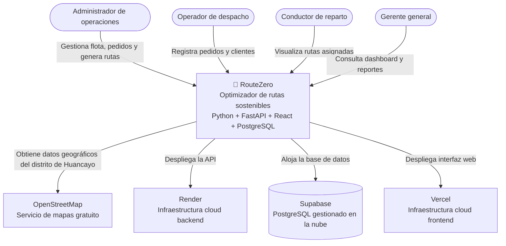
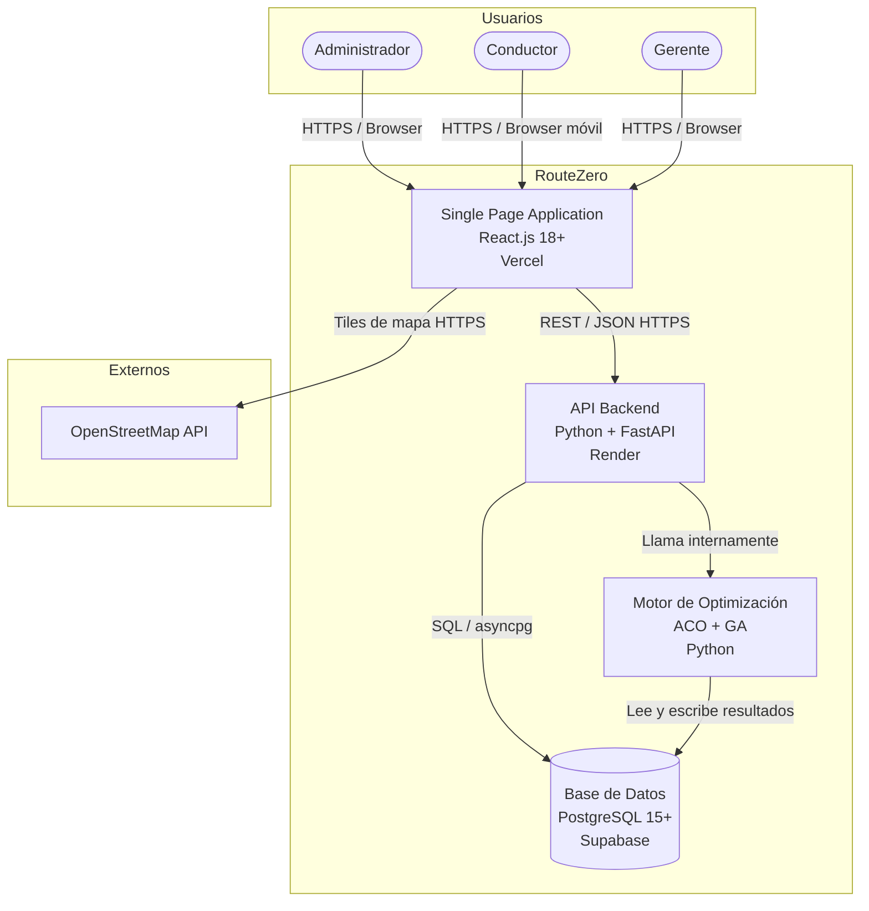
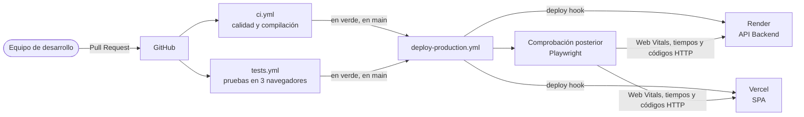
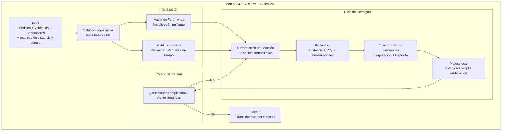

# 12. Modelo C4 — Arquitectura de Software

## Metadatos

| Campo | Detalle |
|---|---|
| **Nombre del Proyecto** | RouteZero — Optimizador de rutas sostenibles |
| **Empresa ficticia** | Andina Reparto S.A.C. |
| **Integrantes** | Inciso Aguilar Elizabeth Antonela, Espinoza Tiza Yago Imanol, Guerra Lozano Keen, Uscuvilca Ramos Abraham Luis |
| **Fecha** | 2026-11-17 |
| **Versión** | 1.3.0 |

[← Volver al README Principal](../../README.md)

## 1. Nivel 1 — Diagrama de Contexto

Muestra el sistema RouteZero en relación con los usuarios externos y sistemas externos con los que interactúa.



## 2. Nivel 2 — Diagrama de Contenedores

Muestra los contenedores principales del sistema RouteZero y cómo se comunican entre sí.



### Flujo de integración y despliegue continuos

Cómo llega un cambio de código a los contenedores desplegados (Render y Vercel), con GitHub Actions como sistema externo:



Los *deploy hooks* son URL secretas guardadas como Secrets de GitHub; el despliegue solo se dispara cuando el CI y las pruebas del mismo commit terminan en verde.

## 3. Nivel 3 — Diagrama de Componentes

Muestra la estructura interna del contenedor API Backend (FastAPI), detallando sus módulos principales.

```mermaid
graph TD
    subgraph API Backend - FastAPI
        MW[Middleware de Seguridad\nJWT Auth + CORS + Rate Limiting + RLS context]

        subgraph Controladores - Routers
            RC[Router Flota\n/api/vehiculos]
            RCON[Router Conductores\n/api/conductores]
            RCLI[Router Clientes\n/api/clientes]
            RP[Router Pedidos\n/api/pedidos]
            RR[Router Rutas\n/api/rutas]
            RA[Router Autenticación\n/api/auth/mfa, /api/auth/sesiones]
            RS[Router Sostenibilidad\n/api/sostenibilidad: dashboard, compensacion, reporte]
            RAUD[Router Auditoría\n/api/auditoria]
        end

        subgraph Servicios - Lógica de Negocio
            SF[Servicio Flota]
            SCON[Servicio Conductores]
            SCLI[Servicio Clientes]
            SP[Servicio Pedidos]
            SR[Servicio Rutas]
            SA[Motor de optimización\nACO + mejora local\n(paquete algoritmo)]
            RV[Red vial\nmatrices por calles\n(paquete red_vial)]
            SM[Servicio MFA]
            SS2[Servicio Sesiones]
            SS[Servicio Sostenibilidad]
        end

        subgraph Repositorios - Acceso a Datos
            RF2[Repositorio Flota]
            RCON2[Repositorio Conductores]
            RCLI2[Repositorio Clientes]
            RAUD2[Repositorio Auditoría]
            RP2[Repositorio Pedidos]
            RR2[Repositorio Rutas]
            RM[Repositorio Métricas]
            RMFA[Repositorio MFA]
            RSES[Repositorio Sesiones]
        end

        GRAF[(Grafo de calles de Huancayo\nOpenStreetMap, archivo .npz)]
        DB[(PostgreSQL en Supabase)]
    end

    SPA[React.js Frontend] -->|REST JSON| MW
    MW --> RC & RCON & RCLI & RP & RR & RA & RS & RAUD

    RC --> SF --> RF2
    RCON --> SCON --> RCON2
    RCLI --> SCLI --> RCLI2
    RAUD --> RAUD2
    RP --> SP --> RP2
    RR --> SR
    SR --> RV
    SR --> SA
    SR --> RR2
    RV --> GRAF
    RA --> SM --> RMFA
    RA --> SS2 --> RSES
    RS --> SS --> RM

    RF2 & RCON2 & RCLI2 & RAUD2 & RP2 & RR2 & RM & RMFA & RSES -->|SQLAlchemy + asyncpg, con RLS por usuario| DB
```

## 4. Nivel 4 — Diagrama de Código (Motor de Optimización ACO)

Muestra la estructura interna del componente crítico del sistema: el motor de optimización ACO.



[← Volver al README Principal](../../README.md)

## Historial de Control de Cambios

| Versión | Fecha | Cambio realizado | Responsable |
|---|---|---|---|
| V_1_0_0 | 2026-09-05 | Versión inicial | Inciso Aguilar Elizabeth Antonela |
| V_1_1_0 | 2026-09-25 | Se reemplaza Render por Supabase como hosting de la base de datos en los niveles 1 y 2; se agrega el Router/Servicio/Repositorio de Autenticación (MFA + sesiones) en el nivel 3, resultado del cambio OpenSpec `add-mfa-sesiones` | Inciso Aguilar Elizabeth Antonela |
| V_1_2_0 | 2026-10-05 | Nivel 3: el servicio de rutas usa la red vial (grafo de calles de OpenStreetMap) y el motor de optimización, ambos como paquetes independientes (`red_vial` y `algoritmo`). Nivel 4: el motor parte de una solución voraz inicial y aplica mejora local a la mejor solución | Inciso Aguilar Elizabeth Antonela |
| V_1_3_0 | 2026-11-17 | El nivel 3 refleja los routers realmente implementados (`/api/sostenibilidad` con dashboard, compensación y reporte, en lugar de `/api/dashboard` y `/api/reportes`; se agregan conductores, clientes y auditoría y se retira `/api/usuarios`, que no existe); el nivel 2 suma el flujo de integración y despliegue continuos con GitHub Actions | Inciso Aguilar Elizabeth Antonela |
