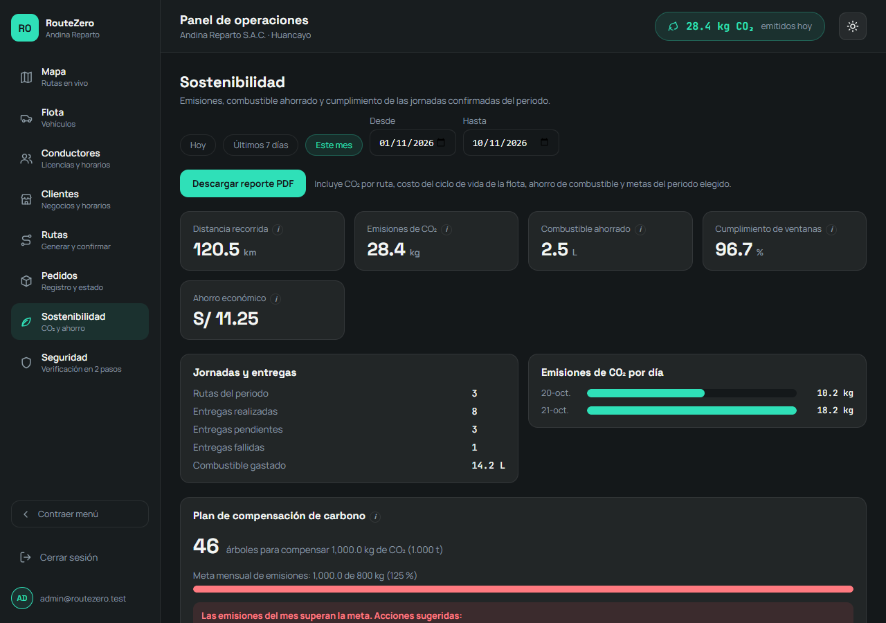
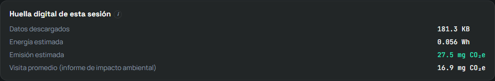
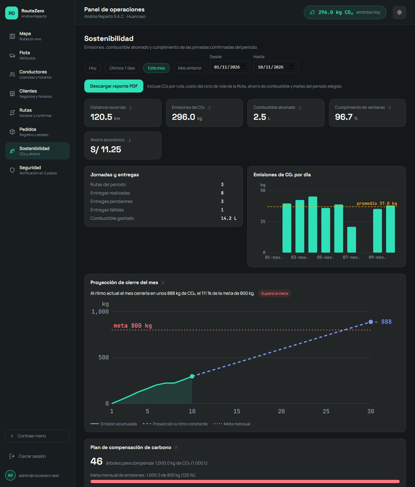

# 01 Informe de Reducción del Impacto Ambiental (Green IT)

## Metadatos

| Campo | Detalle |
|---|---|
| **Nombre del Proyecto** | RouteZero — Optimizador de rutas sostenibles |
| **Empresa ficticia** | Andina Reparto S.A.C. |
| **Líder del Proyecto** | Inciso Aguilar Elizabeth Antonela |
| **Integrantes** | Inciso Aguilar Elizabeth Antonela, Espinoza Tiza Yago Imanol, Guerra Lozano Keen, Uscuvilca Ramos Abraham Luis |
| **Actividad** | Inspección 04 — Green Software y verificación de estándares (actividad de cierre del Sprint 4) |
| **Fecha de las mediciones** | 2026-11-09 (ANTES) y 2026-11-10 (DESPUÉS en producción, tras el Pull Request #91) |
| **Stack evaluado** | React 19 + Vite (Vercel), FastAPI (Render), PostgreSQL (Supabase) |
| **Herramientas** | Lighthouse 13 y Lighthouse CI 0.15.1, Playwright, modelo SWDM v4 verificado contra CO2.js 0.16.9, `svgo`, `curl` |
| **Documento hermano** | [02 Estándares de Ingeniería de Software](02%20Estandares%20Ingenier%C3%ADa%20de%20software%20V_1_4_0.md) |
| **Versión** | 1.4.0 |

[← Volver al README Principal](../../../../../../README.md)

---

## 1. Resumen

Se auditó el consumo de datos y de recursos de RouteZero, se aplicaron mejoras en las 8 áreas de optimización de la actividad (adaptadas a nuestro stack, sección 3) y se midió el efecto antes y después con las mismas herramientas y condiciones.

**Perfil de referencia: escritorio.** El panel de operaciones es una aplicación web que se usa desde una computadora, por eso los umbrales de la rúbrica se leen primero en el perfil de escritorio. El celular (la vista del conductor) se presenta como **complemento**, con todos sus resultados, incluidos los que no cumplen. Es una decisión del equipo; el docente aceptó el enfoque de adaptar las áreas a nuestro stack.

| Indicador (carga inicial de la aplicación) | ANTES | DESPUÉS | Variación |
|---|---|---|---|
| **Escritorio:** peso transferido | 244 KB | 171 KB | **−30 %** |
| **Escritorio:** LCP | 797 ms | 488 ms | **−39 %** |
| JavaScript inicial (sin comprimir) | 553.4 KB | 281.9 KB | **−49 %** |
| JavaScript inicial (comprimido) | 160.4 KB | 87.4 KB | **−46 %** |
| Peticiones a dominios de terceros | 4 | 0 | **−100 %** |
| Emisión estimada por visita (SWDM v4) | 0.0253 g CO₂e | 0.0169 g CO₂e | **−33 %** |
| *Complemento, móvil:* peso transferido | 213 KB | 140 KB | **−34 %** |
| *Complemento, móvil:* FCP | 2.18 s | 1.66 s | **−24 %** |

Medido en **producción** (2026-11-10), con las mismas pantallas y los mismos perfiles que el ANTES y con todas las mejoras desplegadas:

| Indicador en producción (Mapa, Rutas y Conductor) | ANTES (2026-11-09) | DESPUÉS (2026-11-10) | Variación |
|---|---|---|---|
| Rendimiento de Lighthouse | 96 a 100 | **100 en las seis mediciones** | hasta +4 |
| **Escritorio:** FCP | 0.68 a 0.71 s | **0.29 s** | **−57 % a −60 %** |
| **Escritorio:** LCP | 0.68 a 1.00 s | **0.41 s** | **−40 % a −59 %** |
| **Escritorio:** peso transferido | 248 KB | 173 KB | **−30 %** |
| *Complemento, móvil:* FCP | 2.24 a 2.30 s | **0.84 a 0.87 s** | **−61 % a −64 %** |
| *Complemento, móvil:* LCP | 2.26 a 2.30 s | 1.60 s | **−29 % a −31 %** |
| *Complemento, móvil:* peso transferido | 218 KB | 142 KB | **−35 %** |

Estado de las 8 áreas (el docente confirmó el enfoque: **adaptarlas a nuestro stack y no forzar un ANTES y DESPUÉS donde ya se cumplía por diseño**): **5 con ANTES y DESPUÉS** (áreas 1, 2, 4, 6 y 7) y **3 cumplidas por diseño o por la plataforma, cada una explicada y con evidencia** (áreas 3, 5 y 8). Dentro de las áreas 1, 6 y 7 también hay partes que ya se cumplían por diseño (sección 3). Lo que **no** se logró está en la sección 9: en móvil el LCP (1.60 s) supera el umbral de 1.4 s; el FCP móvil sí cumple.

**Novedad de la versión 1.1.0:** el sistema ahora muestra su propia huella: el CO₂ que emitieron hoy las rutas (encabezado) y la huella digital de la sesión calculada con SWDM v4 (pantalla Sostenibilidad); ver la sección 7.5.

**Novedad de la versión 1.3.0:** el primer dibujo de la aplicación ya no espera al JavaScript (cáscara en el HTML y CSS en línea, sección 5.9): con la red limitada de verdad, el FCP en móvil baja de 1 952 a 702 ms; en el laboratorio simulado que usa la rúbrica solo baja de 1 657 a 1 506 ms, y en producción el FCP móvil baja de 1.29 a 1.44 s a 0.84 a 0.87 s (cumple), aunque el LCP móvil sube a 1.60 s (sección 5.9).

**Novedad de la versión 1.4.0:** las 8 áreas se presentan una por una, con lo que pide la rúbrica, su equivalente en nuestro stack, los términos explicados en palabras simples y el código real (sección 5); la paginación de pedidos pasa de 50 a 12 registros (sección 5.2) y se documenta el costo que se evita al usar APIs nativas (sección 5.5).

Todo es reproducible: los comandos están en la sección 10 y los reportes consolidados en la carpeta [`evidencias/`](../evidencias/).

---

## 2. Sensibilización: impactos ambientales del software

El software contamina de forma indirecta: consume electricidad en cada lugar por el que pasan los datos y exige fabricar hardware. Los impactos se reparten en tres momentos.

| Momento | Impacto ambiental | Ejemplo en RouteZero |
|---|---|---|
| **Desarrollo** | Energía de los equipos de desarrollo y de la integración continua (cada ejecución del pipeline enciende un servidor); dependencias pesadas; pruebas repetidas; fabricación del hardware | El CI corre en cada Pull Request; por eso `green-audit.yml` solo se activa si cambia `frontend/` (sección 8) |
| **Despliegue** | Centros de datos (electricidad y refrigeración), servidores encendidos aunque nadie los use, ubicación geográfica y mezcla eléctrica, hosting no renovable | Vercel y Render no figuran como hosting verde (sección 7.4); Render gratuito se apaga por inactividad (arranque en frío) |
| **Uso** | Red de transmisión, energía del dispositivo del usuario (la parte más grande del consumo por GB), batería del celular, renovación de equipos | El conductor usa un celular: cada KB que no se descarga ahorra energía de red y de batería |

Datos del material del curso (SWDM v4): el consumo operativo por GB transferido es de 0.055 kWh en centros de datos, 0.059 kWh en redes y 0.080 kWh en los dispositivos de los usuarios; las tecnologías de la información representan entre el 1.5 % y el 4 % de las emisiones globales. La intensidad promedio de la electricidad mundial es del orden de 480 a 495 g CO₂e/kWh según la fuente.

Idea central: **menos bytes y menos cómputo = menos energía = menos carbono**. Por eso las optimizaciones de este informe atacan primero la cantidad de datos que viaja y la cantidad de código que el navegador debe ejecutar.

---

## 3. Alcance: las 8 áreas adaptadas a nuestro stack

**MERN** es un conjunto de cuatro tecnologías: **M**ongoDB (base de datos), **E**xpress y **N**ode (el servidor, en JavaScript) y **R**eact (la interfaz). La rúbrica de la actividad está escrita para ese stack. RouteZero usa **PostgreSQL** (base de datos), **FastAPI** (servidor en Python) y **React** (la misma interfaz), así que las áreas del frontend se aplican tal cual y las del servidor y la base de datos se aplican con su equivalente. **El docente confirmó este enfoque**: adaptar las 8 áreas a nuestro stack y, cuando un área ya se cumplía por diseño, mencionarla y explicarla en lugar de forzar un antes y un después.

| # | Qué pide la rúbrica (MERN) | Equivalente en RouteZero | Tipo de cumplimiento | Sección |
|---|---|---|---|---|
| 1 | Consultas magras (`.select()`, `.lean()`) e índices en MongoDB | Columnas necesarias con SQL, filas simples sin ORM e índices de PostgreSQL | **Por diseño** (columnas y filas simples) y **con ANTES y DESPUÉS** (índice y `JOIN LATERAL`) | 5.1 |
| 2 | Paginación de 12 registros, en el servidor y en la pantalla | `limite=12` y `desplazamiento` en la API; botón «Cargar más» en Pedidos | **Con ANTES y DESPUÉS** (de 50 a 12) | 5.2 |
| 3 | Imágenes WebP o AVIF con `<picture>` | No hay imágenes PNG ni JPEG; el único SVG ya es liviano | **Por diseño** (no aplica) | 5.3 |
| 4 | `React.lazy` y `Suspense` | Igual, porque también usamos React | **Con ANTES y DESPUÉS** | 5.4 |
| 5 | Sustituir librerías por APIs nativas | Fechas y números con `toLocaleDateString` y `toLocaleString`; sin `moment` ni `lodash` | **Por diseño**, con el costo evitado medido | 5.5 |
| 6 | SVG en línea y menos solicitudes HTTP | Iconos SVG en línea; fuentes propias; CSS dentro del HTML | **Por diseño** (iconos) y **con ANTES y DESPUÉS** (fuentes y CSS) | 5.6 |
| 7 | `Cache-Control`, ETag y React Query | `Cache-Control: immutable` en los archivos; `no-store` en la API | **Con ANTES y DESPUÉS** (archivos) y **por diseño** (API) | 5.7 |
| 8 | Compresión Brotli o gzip (`compression` de Express) | gzip de la API (Render) y Brotli de los archivos (Vercel) | **Por la plataforma**, con medición | 5.8 |

### 3.1 Qué significa «cumplido por diseño» y para qué se mide

En algunas áreas RouteZero ya cumplía desde su construcción: nunca hubo un código «malo» que corregir, así que **no existe un ANTES**. En esos casos el informe muestra tres cosas: (a) el **código actual** que cumple, (b) la **evidencia verificable** (conteos, archivos, cabeceras) y, cuando sirve, (c) cuánto **habría costado no hacerlo** (el «costo evitado»), medido.

Esa medición no se agrega para inventar un antes y un después, sino porque convierte «ya lo cumplimos» en un dato comprobable: muestra que no es casualidad, cuantifica el beneficio de la decisión de diseño y permite que cualquiera lo repita con los datos de la carpeta [`evidencias/`](../evidencias/). Por ejemplo, usar `moment` y `lodash` habría sumado 46.4 KB comprimidos, más de la mitad de todo el JavaScript inicial (sección 5.5).

---

## 4. Metodología de medición

| Aspecto | Detalle |
|---|---|
| **Producción** | `npm run auditar:produccion`: Lighthouse sobre Vercel y Render, con las cuentas de prueba y una ruta de demostración de hoy que se borra al terminar. Pantallas: Mapa, Rutas y Conductor |
| **Local** | `npm run auditar`: la aplicación compilada con `vite preview` y la API simulada en el navegador (datos sintéticos). Misma máquina y mismas condiciones antes y después, por eso es la comparación válida del efecto de cada cambio |
| **Perfiles** | **Escritorio** (`desktop-config`), perfil de referencia porque el panel de operaciones es una aplicación web de computadora, y **móvil** (Lighthouse por defecto: celular de gama media con red 4G lenta simulada), complemento que corresponde a la vista del conductor |
| **Métricas** | Rendimiento, FCP, LCP, TBT, CLS, Speed Index, peso transferido y número de peticiones (ver glosario, sección 11) |
| **ANTES** | Código de `main` al 2026-11-09, antes de esta actividad |
| **DESPUÉS** | Código con las mejoras de la sección 5: en local (comparación controlada) y en producción tras el despliegue |
| **Pipeline** | Lighthouse CI con presupuesto de rendimiento (sección 8) |

Límites de la medición, para no sobreinterpretarla:

- El rendimiento **en producción** depende de la latencia de la API en Render gratuito (cada petición cuesta unos 2 s; IMP-016), que no se controla con cambios de código.
- Las mediciones **locales** no incluyen esa latencia; sirven para aislar el efecto de cada cambio.
- Lighthouse es una medición de **laboratorio** (simulada), no de usuarios reales (datos de campo).
- El DESPUÉS en producción se midió el 2026-11-10, con el cambio ya desplegado en Vercel (sección 6.3).

---

## 5. Las 8 optimizaciones, con código ANTES y DESPUÉS

**Cómo leer esta sección.** Cada área abre con una pequeña tabla: qué pide la rúbrica (pensada para MERN), su equivalente en nuestro stack y el tipo de cumplimiento. Hay dos tipos. **Con ANTES y DESPUÉS**: algo que se cambió, con el código de antes, el de después y su medición. **Por diseño**: algo que RouteZero ya hacía bien desde su construcción, por lo que no hay un ANTES; se muestra el código actual, la evidencia y, cuando sirve, el costo evitado. Los términos técnicos se explican en palabras simples en cada área y de nuevo en el glosario (sección 11).

### 5.1 Consultas e índices de la base de datos

| | |
|---|---|
| **Qué pide la rúbrica (MERN)** | Consultas «magras»: traer solo los campos necesarios (`.select()`), devolver datos simples sin el peso de la librería (`.lean()`) y tener índices para no recorrer tablas enteras |
| **Equivalente en RouteZero** | Consultas SQL que piden solo las columnas necesarias, filas simples sin ORM e índices de PostgreSQL |
| **Tipo de cumplimiento** | **Por diseño** (columnas necesarias y filas simples) y **con ANTES y DESPUÉS** (índice y `JOIN LATERAL`, ítem HT-11) |

**En palabras simples.** `.select()` y `.lean()` son de **Mongoose**, la librería que usa MERN para hablar con **MongoDB**; no existen en PostgreSQL porque cada base lo resuelve a su manera. `.select("nombre precio")` pide solo esos campos y `.lean()` devuelve datos simples en lugar de los objetos pesados que crea la librería (un **ORM** es una capa que convierte las filas de la base en objetos del programa). En SQL, pedir solo lo necesario es escribir las columnas en el `SELECT`, y como RouteZero no usa un ORM, las filas ya llegan simples.

**Cumplido por diseño.** Verificado en el backend: **0** consultas `SELECT *` y **0** clases de ORM (las consultas se escriben en SQL parametrizado y devuelven filas simples). El listado de pedidos pide exactamente las columnas que necesita:

```js
// Referencia de la plantilla (MongoDB + Mongoose)
const products = await Product.find({ status: 'active' }).select('name price category').lean();
```

```python
# RouteZero (PostgreSQL): backend/src/pedidos/repository.py
_COLUMNAS = (
    "pedido_id, cliente_id, descripcion, peso_kg, volumen_m3, prioridad, "
    "latitud, longitud, ventana_inicio, ventana_fin, estado, creado_en"
)
text(f"SELECT {_COLUMNAS} FROM pedidos {where} ORDER BY creado_en DESC, pedido_id LIMIT :limite OFFSET :desplazamiento")
```

**Con ANTES y DESPUÉS: índices y conteo acotado.** Además de lo anterior, se auditaron y mejoraron las consultas con tiempos medidos.

**Diagnóstico.** Con las tablas casi vacías del desarrollo cualquier consulta parece rápida. Se escribió `backend/scripts/auditar_consultas.py`, que carga en una transacción que siempre se deshace el volumen de seis meses de operación (2 700 rutas, 16 200 pedidos) y mide 17 consultas críticas con `EXPLAIN (ANALYZE)` (el plan real de ejecución de PostgreSQL con sus tiempos).

**Implementación.** Dos mejoras reales:

1. Índice para el listado de pedidos sin filtro de estado, que antes ordenaba todos los pedidos en cada petición.
2. El dashboard y el reporte contaban las paradas de **todas** las rutas del historial aunque se pidiera un solo mes.

ANTES:

```sql
-- Dashboard y reporte: agrupaba las paradas de todo el historial
JOIN (SELECT ruta_id, COUNT(*) AS paradas FROM ruta_pedidos GROUP BY ruta_id) p ON p.ruta_id = r.ruta_id
```

DESPUÉS:

```sql
-- Cuenta solo las paradas de las rutas del periodo (JOIN LATERAL: la subconsulta corre por cada fila de `rutas`)
JOIN LATERAL (SELECT COUNT(*) AS paradas FROM ruta_pedidos rp WHERE rp.ruta_id = r.ruta_id) p ON TRUE

-- Índice para ORDER BY creado_en DESC, pedido_id sin filtro de estado
CREATE INDEX IF NOT EXISTS idx_pedidos_creado ON pedidos (creado_en DESC, pedido_id);
```

**Evidencia.** Detalle en [`02 Implementación de la sostenibilidad`](../../../02%20Implementaci%C3%B3n%20de%20la%20sostenibilidad%20V_1_3_0.md), sección 6.

| Consulta | ANTES | DESPUÉS |
|---|---|---|
| Listado de pedidos sin filtro | 7.0 ms | **0.1 ms** |
| Dashboard: totales de 30 días | 6.6 ms | **3.1 ms** |
| Reporte: rutas del periodo | 6.9 ms | **2.5 ms** |
| Las 17 consultas críticas | — | **todas ≤ 42 ms** (umbral: 500 ms) |

Código: [`migracion_indices_ht11.sql`](../../../../../../backend/scripts/migracion_indices_ht11.sql) y [`repository.py` de sostenibilidad](../../../../../../backend/src/sostenibilidad/repository.py).

### 5.2 Paginación

| | |
|---|---|
| **Qué pide la rúbrica (MERN)** | Paginación en el servidor y en la pantalla, de 12 registros por página, para no devolver miles de registros en una sola respuesta |
| **Equivalente en RouteZero** | La API de pedidos recibe `limite` (12 por defecto, máximo 200) y `desplazamiento`; la pantalla Pedidos pide la primera página y un botón «Cargar más» trae las siguientes |
| **Tipo de cumplimiento** | **Con ANTES y DESPUÉS**: la página pasó de 50 a 12 registros |

**En palabras simples.** Paginar es entregar una lista por partes. `limite` es cuántos registros entrega cada petición (*limit*) y `desplazamiento` cuántos se saltan al inicio (*offset*): la segunda página de 12 es `desplazamiento=12`.

**Diagnóstico.** Sin paginar, la respuesta crece con cada pedido registrado. Con los 1 238 pedidos de la base de ejemplo, el tamaño de la respuesta de la API (medido en producción) es:

| Registros por respuesta | Sin comprimir | Comprimido (gzip) |
|---|---|---|
| **12** (página nueva) | 4.6 KB | 1.2 KB |
| 50 (página anterior) | 19.0 KB | 3.4 KB |
| 200 (máximo permitido) | 76.1 KB | 10.0 KB |
| Todos (1 238, estimado a 380 bytes por pedido) | unos 470 KB | — |

ANTES (`backend/src/pedidos/router.py`):

```python
limite: int = Query(50, ge=1, le=200, description="Pedidos por página (máximo 200)"),
```

DESPUÉS:

```python
limite: int = Query(12, ge=1, le=200, description="Pedidos por página (12 por defecto, máximo 200)"),
desplazamiento: int = Query(0, ge=0, description="Pedidos que se omiten al inicio"),
```

La pantalla no envía el tamaño: usa el de la API y pide cada página siguiente con el desplazamiento de lo que ya mostró:

```tsx
// frontend/src/pages/operaciones/PedidosPage.tsx
// La API entrega los pedidos por páginas (12 por defecto): se carga la primera y el resto con "Cargar más".
const pagina = await api.get<PaginaPedidos>(`/api/pedidos?desplazamiento=${pedidos.length}`);
```

**Notas.** La pantalla del Mapa pide `limite=200` de forma expresa porque necesita todos los pedidos pendientes para dibujarlos. La auditoría de la API también acota su respuesta (`limite` de 100 y máximo de 500). **Flota, clientes y conductores no se paginan**: son listas acotadas por el negocio (unas decenas de filas) y paginarlas añadiría peticiones sin ahorro real; la respuesta completa de clientes pesa 6.9 KB sin comprimir y 1.6 KB comprimida (sección 5.8). Las pruebas de la API (`test_pedidos.py`) y de la pantalla (`PedidosPage.test.tsx`) se actualizaron al nuevo tamaño.

### 5.3 Imágenes

| | |
|---|---|
| **Qué pide la rúbrica (MERN)** | Reemplazar las imágenes PNG o JPEG pesadas por formatos modernos (WebP o AVIF) con `<picture>` y `srcset`, para servir a cada pantalla la versión adecuada |
| **Equivalente en RouteZero** | Inventario de las imágenes de la aplicación: no hay imágenes PNG ni JPEG propias, por lo que no hay nada que convertir |
| **Tipo de cumplimiento** | **Por diseño** (no aplica): la aplicación se construyó con gráficos vectoriales y sin imágenes de píxeles |

**En palabras simples.** WebP y AVIF son formatos de imagen que pesan bastante menos que PNG o JPEG con la misma calidad, y `<picture>` deja ofrecer varias versiones para que el navegador elija. Solo sirven para imágenes «de píxeles» (fotos, capturas). Un **SVG** es otra cosa: describe la figura con trazos y ya es muy liviano, por lo que convertirlo a WebP o AVIF lo empeoraría y perdería nitidez.

**Evidencia.** Inventario de lo que la aplicación muestra o descarga como imagen:

| Recurso | Naturaleza | Tamaño | Control |
|---|---|---|---|
| `favicon.svg` | Vectorial | 9 522 B (9.3 KiB) | Propio |
| Código QR de la verificación en dos pasos (Seguridad) | SVG incrustado como imagen, sin petición | — | Propio |
| Mosaicos del mapa (OpenStreetMap) | PNG de un servicio externo | — | De terceros: no se pueden optimizar desde aquí |
| `icons.svg` (eliminado) | Vectorial | 5 031 B | Propio, sin uso |

**Qué se hizo.** Se midió con `svgo` (optimizador de SVG) si `favicon.svg`, el único SVG que se usa, podía reducirse:

```text
favicon.svg: 9.299 KiB - 0.2 % = 9.283 KiB
```

Ya estaba tan reducido como se puede (−0.2 %), así que **no se reemplazó**: el cambio no lo justifica. Aparte, se **eliminó** `public/icons.svg` (5 031 B), un archivo distinto que ningún componente usaba. Los atributos `width` y `height` y la carga prioritaria de la imagen principal tampoco aplican, porque no hay una imagen principal (el CLS medido es de 0.001).

### 5.4 Carga diferida y división de código (`React.lazy`)

| | |
|---|---|
| **Qué pide la rúbrica (MERN)** | Dividir el código con `React.lazy` y `Suspense` para no cargar todas las pantallas al inicio |
| **Equivalente en RouteZero** | Exactamente lo mismo, porque RouteZero también usa React |
| **Tipo de cumplimiento** | **Con ANTES y DESPUÉS** |

**En palabras simples.** `React.lazy` carga el código de una pantalla solo cuando alguien entra a ella, y `Suspense` muestra un mensaje («Cargando…») mientras ese código baja. Dividir el código se llama *code splitting*.

**Diagnóstico.** Todas las pantallas se compilaban en un único archivo de **553 KB** (160 KB comprimido), que incluía Leaflet (la librería de mapas) y las nueve pantallas, y se descargaba entero incluso en el login. Vite lo advertía: *«Some chunks are larger than 500 kB»*.

ANTES (`frontend/src/App.tsx`):

```tsx
import { MapaPage } from "./pages/operaciones/MapaPage";
import { FlotaPage } from "./pages/operaciones/FlotaPage";
// ... las nueve pantallas importadas de forma estática
```

DESPUÉS:

```tsx
// Cada pantalla es su propio trozo de código, que solo se descarga al entrar a ella.
const MapaPage = lazy(() => import("./pages/operaciones/MapaPage").then((m) => ({ default: m.MapaPage })));
const FlotaPage = lazy(() => import("./pages/operaciones/FlotaPage").then((m) => ({ default: m.FlotaPage })));
// ... (las nueve pantallas; el login y el layout siguen cargándose de inmediato)
```

```tsx
// frontend/src/layout/OperacionesLayout.tsx: el menú y el encabezado se quedan mientras baja el trozo
<Suspense fallback={<p role="status" style={{ margin: 0, padding: 24, color: "var(--rz-text-muted)" }}>Cargando…</p>}>
  <Outlet />
</Suspense>
```

**Evidencia.** Salida de `npm run build`:

| Archivo | ANTES | DESPUÉS |
|---|---|---|
| `index.js` (inicial) | 553.40 KB (160.44 comprimido) | **281.92 KB (87.35 comprimido)** |
| `index.css` (inicial) | 17.71 KB | 3.53 KB |
| Leaflet (trozo aparte, solo al abrir una pantalla con mapa) | dentro del inicial | 152.33 KB (44.62 comprimido) + 15.09 KB de CSS |
| Cada pantalla | dentro del inicial | de 6.6 KB (Clientes) a 17.3 KB (Rutas) |

Efecto medido en el login (local): peso 213 → 140 KB en móvil y FCP móvil 2.18 → 1.66 s. Una observación honesta: en el Mapa, que es la pantalla que más trozos encadena (Leaflet incluido), el LCP móvil subió de 2.17 s a 2.45 s en una de las corridas con solo esta mejora y volvió a 1.8 s en las siguientes; es variación entre ejecuciones, no una mejora ni un empeoramiento confirmado.

**Validación de que no se rompió nada:** 147 de 147 pruebas de Vitest y 33 de 33 de Playwright (escritorio y celular), antes y después.

### 5.5 Dependencias y APIs nativas

| | |
|---|---|
| **Qué pide la rúbrica (MERN)** | Sustituir librerías por las funciones nativas del navegador (la plantilla del docente lo ejemplifica con `moment.js` y `lodash`, reemplazadas por `Intl.DateTimeFormat` y `Set`) |
| **Equivalente en RouteZero** | RouteZero no usa librerías de fechas ni de utilidades: da formato con las APIs nativas y solo tiene 5 dependencias de ejecución |
| **Tipo de cumplimiento** | **Por diseño**: no hay un ANTES; se mide cuánto habría costado no hacerlo |

**En palabras simples.**

- **`moment.js` y `lodash`** son librerías muy usadas (la primera para fechas, la segunda para listas y objetos), pero pesadas.
- **`toLocaleDateString` y `toLocaleString`** son funciones nativas de JavaScript que dan formato a fechas y números según el idioma. Funcionan sobre `Intl.DateTimeFormat` e `Intl.NumberFormat`, la API de internacionalización del navegador, por eso son de la misma familia.
- **`Set`** es una colección nativa que no admite elementos repetidos; reemplaza, por ejemplo, a la función `uniq` de `lodash`.

**Cumplido por diseño.** El frontend da formato a fechas y números con las funciones nativas, en 7 archivos, y no importa ninguna librería de fechas ni de utilidades:

```ts
// frontend/src/components/GraficosSostenibilidad.tsx
const numero = (valor: number, decimales = 1) =>
  valor.toLocaleString("es-PE", { minimumFractionDigits: decimales, maximumFractionDigits: decimales });
const fechaCorta = (texto: string) => aFecha(texto).toLocaleDateString("es-PE", { day: "2-digit", month: "short" });
```

Las dependencias de ejecución del frontend (`frontend/package.json`) son solo cinco, todas imprescindibles:

```json
"dependencies": {
  "leaflet": "^1.9.4", "react": "^19.2.8", "react-dom": "^19.3.1",
  "react-leaflet": "^5.0.0", "react-router-dom": "^7.18.4"
}
```

En el backend, `numpy` y `scipy` sostienen el motor de optimización (ACO) y `fpdf2` genera el reporte PDF: cada una tiene un uso concreto. Para que no se acumulen dependencias, Dependabot propone actualizaciones y el CI ejecuta `npm audit --audit-level=high`, Bandit y `pip-audit` en cada Pull Request. Lo único sobrante que se encontró fue el archivo `public/icons.svg` (sección 5.3), ya eliminado.

**Costo evitado (medido).** Para dimensionar lo que se evita, se midió en una carpeta temporal el mismo ejemplo mínimo escrito con las librerías y con lo nativo (método y datos en [`costo-moment-lodash-vs-nativo.md`](../evidencias/costo-moment-lodash-vs-nativo.md)):

| Versión | Sin comprimir | Comprimido (gzip) |
|---|---|---|
| `moment` + `lodash` | 135.6 KB | 46.4 KB |
| APIs nativas | 223 B | 215 B |

Las dos librerías habrían sumado un **53 %** al JavaScript inicial de RouteZero (87.4 KB comprimidos). Es un ejemplo con las librerías completas: con versiones recortables el costo sería menor, pero el orden de magnitud se mantiene.

### 5.6 Solicitudes HTTP y SVG en línea

| | |
|---|---|
| **Qué pide la rúbrica (MERN)** | Reducir las peticiones HTTP: los iconos SVG críticos van dentro del código y no como un archivo por icono |
| **Equivalente en RouteZero** | Iconos SVG como componentes en línea (ya era así) y, en esta actividad, fuentes propias en lugar de Google Fonts y el CSS principal dentro del HTML |
| **Tipo de cumplimiento** | **Por diseño** (iconos) y **con ANTES y DESPUÉS** (fuentes y CSS) |

**En palabras simples.** Cada archivo que el navegador debe pedir cuesta una ida y vuelta por la red, y más si viene de otro dominio (un **tercero**, como Google Fonts). Un **SVG en línea** es un icono escrito dentro del propio código de la pantalla: no hay archivo que pedir.

**Iconos: cumplido por diseño.** Los iconos del menú y de las pantallas son componentes con el SVG dentro del código; no hay un archivo por icono:

```tsx
// frontend/src/layout/OperacionesLayout.tsx
function IconoMapa() {
  return (
    <svg aria-hidden="true" width="20" height="20" viewBox="0 0 24 24" fill="none" stroke="currentColor" strokeWidth="1.8" strokeLinecap="round" strokeLinejoin="round">
      <path d="M9 20l-5.5 2V6L9 4m0 16l6 2m-6-2V4m6 18l5.5-2V4L15 6m0 16V6m0 0L9 4" />
    </svg>
  );
}
```

**Fuentes y CSS: con ANTES y DESPUÉS.** La lista completa de peticiones de la pantalla de inicio de sesión, medida con Chrome contra producción:

ANTES (8 peticiones, **4 de terceros**; medido el 2026-11-09):

| # | Recurso | Dominio |
|---|---|---|
| 1 | Documento HTML | Propio |
| 2 | Hoja de estilos principal (`index.css`) | Propio |
| 3 | Hoja de estilos de Google Fonts | **Tercero** (`fonts.googleapis.com`) |
| 4 | JavaScript | Propio |
| 5 | `favicon.svg` | Propio |
| 6 a 8 | Tres archivos de fuentes: Manrope, JetBrains Mono y Space Grotesk (78 KB en total) | **Tercero** (`fonts.gstatic.com`) |

DESPUÉS (**7 peticiones en escritorio y 6 en móvil, 0 de terceros**; medido el 2026-11-12):

| # | Recurso | Dominio |
|---|---|---|
| 1 | Documento HTML, ahora con el CSS principal dentro | Propio |
| 2 y 3 | JavaScript: `index` y `jsx-runtime` (el código se dividió con `React.lazy`, sección 5.4) | Propio |
| 4 | `favicon.svg` | Propio |
| 5 a 7 | Fuentes Manrope, Space Grotesk y, solo en escritorio, JetBrains Mono | **Propio** |

**Por qué «solo bajó una».** De 8 a 7 hay tres movimientos: se quitaron **2** peticiones (la hoja de Google Fonts y el CSS principal, ahora dentro del HTML) y se sumó **1** (un trozo más de JavaScript, por la división de código). Las tres fuentes siguen existiendo, pero ahora son del propio dominio. En móvil pasa de 7 a 6 por lo mismo (allí no se pide JetBrains Mono). Lo importante no es tanto la cantidad como su naturaleza: **las peticiones a terceros pasaron de 4 a 0** y **2 peticiones que bloqueaban el primer dibujo desaparecieron**. El CSS en línea es parte de esta área y se detalla en la sección 5.9.

ANTES (`frontend/index.html`):

```html
<link rel="preconnect" href="https://fonts.googleapis.com" />
<link rel="preconnect" href="https://fonts.gstatic.com" crossorigin />
<link href="https://fonts.googleapis.com/css2?family=Space+Grotesk:wght@500;600;700&family=Manrope:wght@400;500;600;700&family=JetBrains+Mono:wght@500;600&display=swap" rel="stylesheet" />
```

DESPUÉS: se quitan esas líneas y las **mismas tres familias** (licencia SIL Open Font License 1.1) se sirven desde nuestro propio dominio, en su versión variable y solo con el subconjunto latino que cubre el español:

```css
/* frontend/src/theme/tokens.css (una de las tres) */
@font-face {
  font-family: "Manrope";
  font-style: normal;
  font-weight: 400 700;
  font-display: swap;
  src: url("../assets/fonts/manrope-latin.woff2") format("woff2");
  unicode-range: U+0000-00FF, U+0131, U+0152-0153, /* ... subconjunto latino ... */;
}
```

Se probó también seguir con Google Fonts pidiendo pesos variables (`wght@400..700`): **no cambió nada medible**, porque Google ya servía un archivo por familia. Lo que sí ayudó fue autoalojar.

**Evidencia** (verificado en el navegador con la aplicación compilada):

```text
Fuentes: Space Grotesk 500 700 loaded | Manrope 400 700 loaded | JetBrains Mono 500 600 loaded
Peticiones a dominios externos: 0
font-family del body: Manrope, sans-serif
```

Efecto medido en escritorio (local): FCP 510 → 368 ms (−28 %) y LCP 797 → 488 ms (−39 %). En móvil no hubo mejora adicional con este cambio (el FCP móvil se mantuvo en 1.66 s, limitado por la simulación de red lenta). El aspecto visual no cambia: las mismas familias y los mismos pesos. En producción el HTML servido ya no contiene ninguna referencia a Google Fonts.

### 5.7 Caché de recursos

| | |
|---|---|
| **Qué pide la rúbrica (MERN)** | Cabeceras de caché: `Cache-Control` con `immutable` para los archivos estáticos, ETag para que la API conteste «no cambió» y React Query para guardar en el cliente lo ya pedido |
| **Equivalente en RouteZero** | Cabeceras `Cache-Control` en los archivos estáticos (Vercel) y política de caché de la API (FastAPI) |
| **Tipo de cumplimiento** | **Con ANTES y DESPUÉS** (archivos estáticos) y **por diseño** (la API) |

**En palabras simples.**

- **`Cache-Control`**: instrucciones del servidor al navegador sobre cuánto tiempo guardar una respuesta.
- **`max-age=31536000, immutable`**: «guarda este archivo un año (31 536 000 segundos) y no vuelvas a preguntar si cambió». Es seguro cuando el archivo lleva un **hash** en el nombre (`index-xxxx.js`), porque si el contenido cambia, cambia el nombre.
- **ETag**: una huella de la respuesta. El navegador pregunta «¿cambió?» y el servidor puede contestar «no» (código 304) sin reenviar los datos.
- **`no-store`**: «no guardes esta respuesta en ningún lado».
- **React Query**: librería de React que guarda en memoria lo que ya se pidió a la API.

#### A. Archivos estáticos: con ANTES y DESPUÉS

**Diagnóstico.** Se inspeccionaron las cabeceras reales de Vercel. Los archivos de `/assets/` llevan un nombre con hash (`index-DE2H_Ds6.js`), pero se servían con:

```text
Cache-Control: public, max-age=0, must-revalidate
Etag: "4744734762dc3ca4a2cf71a3e626d64a"
```

Es decir, el navegador volvía a preguntar al servidor si el archivo había cambiado en **cada visita** (una petición de validación que responde 304), aunque un archivo con ese nombre nunca puede cambiar de contenido.

ANTES: sin regla para `/assets/`. DESPUÉS (`frontend/vercel.json`):

```json
{
  "source": "/assets/(.*)",
  "headers": [{ "key": "Cache-Control", "value": "public, max-age=31536000, immutable" }]
}
```

El `index.html` **no** se cachea así: debe revalidarse para que apunte a los archivos nuevos tras cada despliegue. **Verificación en producción (2026-11-10):** `curl -sI https://route-zero-omega.vercel.app/assets/index-CExP8iu6.js` devuelve `Cache-Control: public, max-age=31536000, immutable`; desde la segunda visita el navegador ya no pregunta por esos archivos.

#### B. La API: por diseño

Las respuestas de la API llevan `no-store` **a propósito**, por seguridad (OWASP A02): contienen datos de usuarios autenticados (rutas, conductores, el DNI) y no deben quedar guardados en el navegador ni en un intermediario.

```python
# backend/src/main.py
if request.url.path.startswith("/api/"):
    respuesta.headers.setdefault("Cache-Control", "no-store")
```

Como el navegador no guarda una copia, no hay contra qué comparar un ETag, y por eso la API no lo usa; React Query tampoco hace falta, porque cada pantalla pide sus datos al abrirse y las listas son pequeñas. La caché útil de los datos está en el **servidor**: el mapa con los trazados por calles tarda 9.3 s la primera vez y 2.6 s desde la caché.

### 5.8 Compresión de la API

| | |
|---|---|
| **Qué pide la rúbrica (MERN)** | Comprimir las respuestas con Brotli o gzip (en Express, con el middleware `compression`) |
| **Equivalente en RouteZero** | gzip en las respuestas de la API (Render) y Brotli en los archivos estáticos (Vercel) |
| **Tipo de cumplimiento** | **Por la plataforma de despliegue**, con medición: no hay código de compresión propio, por eso no hay un ANTES en el repositorio |

**En palabras simples.** **gzip** y **Brotli** son algoritmos que comprimen texto (HTML, JSON, JavaScript, CSS) antes de enviarlo; el navegador lo descomprime al recibirlo. gzip es el clásico y funciona en todas partes; Brotli, creado por Google, comprime algo mejor y exige HTTPS. En MERN la compresión se agrega desde la aplicación con el middleware `compression`; en RouteZero **la hace la plataforma que la aloja**: Render comprime con gzip lo que responde la API, y Vercel sirve con Brotli los archivos del frontend. «No añadimos nada a nuestro código» significa que no escribimos código de compresión.

**Evidencia.** Se midieron tres respuestas reales de la API en Render, con y sin permitir la compresión (`Accept-Encoding`):

| Endpoint | Sin comprimir | Comprimido con gzip | Reducción |
|---|---|---|---|
| `GET /api/pedidos?limite=12` | 4 597 B | 1 151 B | **75 %** |
| `GET /api/clientes` | 6 878 B | 1 599 B | **77 %** |
| `GET /api/rutas/mapa` | 5 791 B | 1 651 B | **72 %** |

La respuesta comprimida llega con la cabecera `Content-Encoding: gzip`, y los archivos del frontend con `Content-Encoding: br` (Brotli).

**Decisión.** No se añadió compresión en la aplicación: duplicaría el trabajo con 0.1 CPU en el plan gratuito y comprimiría también el reporte PDF, que ya es un formato comprimido (se medían 7.5 s para el PDF de 30 días). Se documenta la medición como evidencia y el supuesto: si en el futuro se despliega fuera de Render, se agregará `GZipMiddleware(minimum_size=1024)` de Starlette, excluyendo el PDF.

### 5.9 Primer dibujo: cáscara de la aplicación y CSS en línea — implementada y medida en producción

Esta mejora se suma a las ocho áreas: ataca el FCP móvil, que seguía por encima del umbral de la rúbrica.

**Diagnóstico.** RouteZero es una aplicación de una sola página (SPA): su HTML solo trae un `<div id="root"></div>` vacío y, hasta que el navegador descarga y ejecuta el JavaScript, la pantalla queda en blanco. Además la hoja de estilos principal (unos 4 KB) es una petición más que bloquea el primer dibujo. Es la causa del FCP de móvil que seguía por encima de 1.0 s (secciones 6.3 y 6.4).

ANTES (`frontend/index.html`):

```html
<div id="root"></div>
<!-- y, al compilar, un <link rel="stylesheet" href="/assets/index-xxxx.css"> que bloqueaba el primer dibujo -->
```

DESPUÉS:

```html
<div id="root">
  <!-- Cáscara de la aplicación: se dibuja con el propio HTML y el CSS en línea, sin esperar al JavaScript; React la reemplaza al arrancar. -->
  <main class="rz-cascara">Cargando…</main>
</div>
```

```ts
// frontend/vite.config.ts: al compilar, el CSS principal va dentro del HTML en lugar de enlazarse (las hojas de los trozos
// diferidos, como la de Leaflet, siguen cargándose aparte)
function cssPrincipalEnLinea(): Plugin { /* reemplaza el <link rel="stylesheet"> por <style>…</style> */ }
```

La cáscara es **idéntica a la pantalla «Cargando…» que App.tsx ya mostraba** mientras se comprueba la sesión (mismo estilo, mismo texto), de modo que React la reemplaza sin que nada se mueva. Un pequeño script en el `<head>` aplica el tema guardado antes del primer dibujo: sin él, quien eligió el tema claro vería un destello oscuro. Se comprobó con el JavaScript bloqueado que la cáscara sale con el fondo correcto en los dos temas (claro `rgb(245, 247, 246)` y oscuro `rgb(20, 24, 26)`).

**Resultados** (pantalla de inicio de sesión, perfil móvil, 3 repeticiones, mediana, en local):

| Método de medición | Métrica | Sin cáscara | Con cáscara | Variación |
|---|---|---|---|---|
| Lighthouse **simulado** (el del CI y el de la rúbrica) | FCP | 1 657 ms | 1 506 ms | −9 % |
| | LCP | 1 807 ms | 1 806 ms | sin cambio |
| **Red limitada de verdad** (throttling del navegador) | FCP | 1 952 ms | **702 ms** | **−64 %** |
| | LCP | 2 135 ms | 2 219 ms | +4 % (dentro de la variación entre corridas) |

**Por qué el modo simulado casi no lo ve.** Lighthouse mide en una máquina rápida y después *simula* una 4G lenta sobre lo que cargó antes del primer dibujo. Con el servidor en el mismo equipo, el JavaScript (85 KB) y la fuente terminan de cargarse a los 42 ms, antes del primer dibujo observado (61 ms), y la simulación los cuenta como si hubiera que bajarlos por la red lenta. En un servidor real con latencia (Vercel), la cáscara se dibuja antes de que llegue el JavaScript, por eso la medición con red limitada de verdad (702 ms) refleja mejor lo que vive el usuario. El resultado en producción está en la tabla siguiente.

**Resultado en producción (2026-11-10, tras el despliegue; Mapa, Rutas y Conductor).** Reporte: [`lighthouse-produccion-CON-CASCARA-2026-11-10.json`](../evidencias/lighthouse-produccion-CON-CASCARA-2026-11-10.json).

| Perfil | Métrica | Sin cáscara (mañana) | Con cáscara (tarde) |
|---|---|---|---|
| Escritorio | FCP | 0.40 a 0.41 s | **0.29 s** |
| Escritorio | LCP | 0.41 s | 0.41 s |
| Móvil | FCP | 1.29 a 1.44 s | **0.84 a 0.87 s** (cumple el umbral de 1.0 s) |
| Móvil | LCP | 1.31 a 1.44 s | **1.60 s** (empeoró y supera el umbral de 1.4 s) |

**Por qué el LCP móvil sube.** Con la cáscara, el primer contenido (FCP) aparece antes, pero el contenido final (LCP) sigue necesitando el JavaScript, y antes ambos coincidían. En el laboratorio simulado, el LCP debe esperar la cadena HTML → JavaScript (87.6 KB) → fuentes, que el navegador descubre recién después de ejecutar el JavaScript: unos 1.6 s con la red lenta simulada, aunque en la medición real el título del inicio de sesión aparece a los 655 ms. Se probó precargar las dos fuentes en el HTML para acortar esa cadena: con la red limitada de verdad **empeoró** (FCP de 702 a 1 055 ms y LCP de 2 219 a 2 377 ms, porque las fuentes compiten con el JavaScript por el ancho de banda) y se descartó.

**Límites, dichos con claridad.**

- El FCP mide «el primer contenido»: con la cáscara, ese contenido es el texto «Cargando…». Es lo que ya veía el usuario durante la comprobación de la sesión, y evita la pantalla en blanco, pero **no** acelera cuándo aparece la pantalla real.
- El **LCP no mejora**: depende del contenido real, que sigue necesitando el JavaScript.
- No se llegó a 1.0 s en el modo simulado. Hacerlo exigiría reducir más el JavaScript inicial (87 KB comprimidos) o renderizar en el servidor, con mucha más complejidad.

**Validación.** Vitest 178 de 178, Playwright 35 de 35, build correcto, y los presupuestos de Lighthouse CI siguen pasando en escritorio y móvil.

---

## 6. Resultados antes y después

### 6.1 Comparación controlada (local, mismas condiciones), pantalla de inicio de sesión

| Métrica | Móvil ANTES | Móvil DESPUÉS | Escritorio ANTES | Escritorio DESPUÉS |
|---|---|---|---|---|
| Rendimiento (0 a 100) | 96 | **99** | 100 | 100 |
| FCP | 2 176 ms | **1 657 ms** | 510 ms | **368 ms** |
| LCP | 2 176 ms | **1 807 ms** | 797 ms | **488 ms** |
| TBT | 7 ms | 0 ms | 0 ms | 0 ms |
| CLS | 0.004 | 0.006 | 0.001 | 0.001 |
| Speed Index | 2 176 ms | 1 657 ms | 510 ms | 368 ms |
| Peso transferido | 213 KB | **140 KB** | 244 KB | **171 KB** |
| Peticiones | 7 | 7 | 8 | 8 |

Después de los cambios, accesibilidad, buenas prácticas y SEO quedan en **100** en las doce mediciones (seis pantallas × dos perfiles) y el rendimiento mínimo es 99; antes, el mínimo de rendimiento era 95 y una medición (Mapa en móvil) tenía 96 en buenas prácticas. Reporte completo: [`lighthouse-local-ANTES-2026-11-09.json`](../evidencias/lighthouse-local-ANTES-2026-11-09.json) y [`lighthouse-local-DESPUES-2026-11-09.json`](../evidencias/lighthouse-local-DESPUES-2026-11-09.json).

### 6.2 Producción ANTES (2026-11-09, Vercel y Render)

| Pantalla | Perfil | Rend. | FCP | LCP | TBT | CLS | Peso | Peticiones |
|---|---|---|---|---|---|---|---|---|
| Mapa | Escritorio | 98 | 713 ms | 1 004 ms | 0 ms | 0.001 | 248 KB | 8 |
| Rutas | Escritorio | 99 | 696 ms | 696 ms | 0 ms | 0.001 | 248 KB | 8 |
| Conductor | Escritorio | 100 | 682 ms | 682 ms | 0 ms | 0.001 | 248 KB | 8 |
| Mapa | Móvil | 96 | 2 296 ms | 2 296 ms | 6 ms | 0 | 218 KB | 7 |
| Rutas | Móvil | 96 | 2 237 ms | 2 256 ms | 0 ms | 0 | 218 KB | 7 |
| Conductor | Móvil | 96 | 2 304 ms | 2 304 ms | 0 ms | 0 | 218 KB | 7 |

Reporte: [`lighthouse-produccion-ANTES-2026-11-09.json`](../evidencias/lighthouse-produccion-ANTES-2026-11-09.json). Dato operativo del día: Render tardó **52 s** en responder tras su arranque en frío y el proyecto de Supabase estaba pausado por inactividad (plan gratuito); hubo que restaurarlo antes de medir.

### 6.3 Producción DESPUÉS de las áreas 1 a 8 (2026-11-10, mañana, Vercel y Render)

Mismo procedimiento, pantallas y cuentas que el ANTES, con el Pull Request #91 ya desplegado.

| Pantalla | Perfil | Rend. | FCP | LCP | TBT | CLS | Peso | Peticiones |
|---|---|---|---|---|---|---|---|---|
| Mapa | Escritorio | 100 | 411 ms | 416 ms | 0 ms | 0.001 | 173 KB | 8 |
| Rutas | Escritorio | 100 | 402 ms | 408 ms | 0 ms | 0.001 | 173 KB | 8 |
| Conductor | Escritorio | 100 | 407 ms | 407 ms | 0 ms | 0.001 | 173 KB | 8 |
| Mapa | Móvil | 100 | 1 432 ms | 1 432 ms | 0 ms | 0 | 142 KB | 7 |
| Rutas | Móvil | 100 | 1 441 ms | 1 441 ms | 6 ms | 0 | 142 KB | 7 |
| Conductor | Móvil | 100 | 1 290 ms | 1 307 ms | 8 ms | 0 | 142 KB | 7 |

Accesibilidad, buenas prácticas y SEO: **100** en las seis mediciones. Reporte: [`lighthouse-produccion-DESPUES-2026-11-10.json`](../evidencias/lighthouse-produccion-DESPUES-2026-11-10.json). La mejora en producción es mayor que en local (FCP móvil de 1.29 a 1.44 s frente a 1.66 s); probablemente se debe a que Vercel sirve los archivos por HTTP/2 y con Brotli desde una red de distribución de contenido, mientras que `vite preview` no lo hace, pero esa explicación no se verificó.

### 6.4 Cumplimiento de los umbrales de la rúbrica (producción, antes y después)

Las dos primeras columnas son el **perfil de referencia (escritorio)**; las dos últimas, el **complemento móvil** (vista del conductor). Los valores de «DESPUÉS» son los finales, con la cáscara de la sección 5.9 desplegada ([reporte](../evidencias/lighthouse-produccion-CON-CASCARA-2026-11-10.json)). No se omite ningún resultado: el móvil no cumple el LCP.

| Umbral | Escritorio ANTES | Escritorio DESPUÉS | Móvil ANTES | Móvil DESPUÉS |
|---|---|---|---|---|
| Rendimiento ≥ 90 | 98 a 100 ✔ | 100 ✔ | 96 ✔ | 100 ✔ |
| FCP ≤ 1.0 s | 0.68 a 0.71 s ✔ | 0.29 s ✔ | 2.24 a 2.30 s ✘ | 0.84 a 0.87 s ✔ |
| LCP ≤ 1.4 s | 0.68 a 1.00 s ✔ | 0.41 s ✔ | 2.26 a 2.30 s ✘ | 1.60 s **✘** |
| TBT ≤ 85 ms | 0 ms ✔ | 0 ms ✔ | 0 a 6 ms ✔ | 0 a 23 ms ✔ |
| CLS ≤ 0.02 | 0.001 ✔ | 0 a 0.001 ✔ | 0 ✔ | 0 ✔ |
| Peso ≤ 1.1 MB | 248 KB ✔ | 173 KB ✔ | 218 KB ✔ | 142 KB ✔ |

**En escritorio se cumplen todos los umbrales. En móvil se cumplen todos salvo el LCP (1.60 s contra 1.4 s).** La causa es la simulación de móvil de Lighthouse (red 4G lenta y CPU reducida), explicada en la sección 5.9. Se declara así, sin forzar las cifras.

### 6.5 Evolución histórica

El proyecto ya había mejorado antes de esta actividad. Lighthouse en producción: en el Sprint 2 el mapa daba 88 a 89 y Pedidos 85 de rendimiento; el 22-10-2026 todas las pantallas quedaron entre 91 y 98 (detalle en [`06 Calidad de la interfaz y pruebas de extremo a extremo`](../../../../Sprint%203/06%20Calidad%20de%20la%20interfaz%20y%20pruebas%20de%20extremo%20a%20extremo%20V_1_1_0.md), sección 2.3).

---

## 7. Huella de carbono con el modelo SWDM v4

### 7.1 El modelo

**SWDM** (*Sustainable Web Design Model*, Modelo de Diseño Web Sostenible) estima la energía y las emisiones de transferir datos por internet. Lo desarrolla la Green Web Foundation y es la base de CO2.js. Divide cada GB transferido en **tres segmentos** (centro de datos, red y dispositivo del usuario) y en **dos componentes**:

| Segmento | Energía operativa (kWh/GB) | Energía incorporada (kWh/GB) |
|---|---|---|
| Centro de datos | 0.055 | 0.012 |
| Red de transmisión | 0.059 | 0.013 |
| Dispositivo del usuario | 0.080 | 0.081 |
| **Total** | **0.194** | **0.106** |

- **Energía operativa:** la electricidad que se gasta al usar el equipo.
- **Energía incorporada** (*embodied*): la energía que costó fabricar el hardware, repartida por uso. El material del curso solo muestra la operativa; el modelo completo suma ambas (**0.300 kWh/GB**).

Fórmulas:

```text
energía (kWh)   = GB transferidos × kWh/GB de cada segmento y componente
emisión (g CO2e) = energía (kWh) × intensidad de la red eléctrica (g CO2e/kWh)
```

Parámetros usados:

| Parámetro | Valor | Fuente |
|---|---|---|
| Intensidad global | 494 g CO₂e/kWh | Constante de SWDM v4 en CO2.js 0.16.9 (las diapositivas del curso citan 481; se muestra la sensibilidad) |
| Intensidad de Perú | 263.27 g CO₂e/kWh | Datos de promedio de CO2.js |
| Hosting verde | No (factor 0) | Green Web Foundation: Vercel y Render no figuran como verdes (consulta del 2026-11-10) |
| Visitas | 75 % nuevas y 25 % de retorno, que recargan el 2 % de los datos | Valores por defecto del modelo |
| 1 GB | 1 000 000 000 bytes | Igual que CO2.js |

La intensidad del país afecta solo a la energía **operativa**; la incorporada usa siempre la global, como en la implementación de referencia.

### 7.2 Ejemplo calculado paso a paso

Carga inicial en **móvil ANTES**: 213 KB = 213 × 1 024 = 218 112 bytes = 0.000218112 GB.

| Segmento | Energía operativa (kWh) | Emisión operativa (g) | Energía incorporada (kWh) | Emisión incorporada (g) |
|---|---|---|---|---|
| Centro de datos | 0.000218112 × 0.055 = 1.1996 × 10⁻⁵ | × 494 = 0.005926 | × 0.012 = 2.617 × 10⁻⁶ | × 494 = 0.001293 |
| Red | × 0.059 = 1.2869 × 10⁻⁵ | × 494 = 0.006357 | × 0.013 = 2.835 × 10⁻⁶ | × 494 = 0.001401 |
| Dispositivo | × 0.080 = 1.7449 × 10⁻⁵ | × 494 = 0.008620 | × 0.081 = 1.7667 × 10⁻⁵ | × 494 = 0.008728 |
| **Suma** | **4.2314 × 10⁻⁵ kWh** | **0.020903 g** | **2.3120 × 10⁻⁵ kWh** | **0.011421 g** |

**Energía total = 6.543 × 10⁻⁵ kWh; emisión total = 0.020903 + 0.011421 = 0.032324 g CO₂e.**

### 7.3 Resultados

Carga inicial (visita nueva, intensidad global):

| Perfil | Momento | Peso (KB) | Energía total (kWh) | Emisión (g CO₂e) |
|---|---|---|---|---|
| Móvil | ANTES | 213 | 6.543 × 10⁻⁵ | 0.032324 |
| Móvil | DESPUÉS | 140 | 4.301 × 10⁻⁵ | 0.021246 |
| Escritorio | ANTES | 244 | 7.496 × 10⁻⁵ | 0.037029 |
| Escritorio | DESPUÉS | 171 | 5.253 × 10⁻⁵ | 0.025950 |

**Proyección anual.** Escenario declarado como **supuesto** (no son datos de operación real): 20 usuarios (1 administrador, 4 operadores y 15 conductores, uno por vehículo) × 260 días hábiles × 2 sesiones = **10 400 visitas/año**, con 75 % desde celular (los conductores).

| Concepto | ANTES | DESPUÉS | Ahorro |
|---|---|---|---|
| Peso ponderado por visita | 220.75 KB | 147.75 KB | 33.1 % |
| Emisión por visita | 0.025293 g | 0.016929 g | 33.1 % |
| Energía al año | 0.5325 kWh | 0.3564 kWh | 0.1761 kWh |
| **Emisión al año** | **263.04 g CO₂e** | **176.06 g CO₂e** | **86.99 g CO₂e** |

Con los **pesos medidos en producción** (móvil 218 → 142 KB y escritorio 248 → 173 KB, secciones 6.2 y 6.3) el resultado es casi idéntico: peso ponderado por visita 225.50 → 149.75 KB (−33.6 %), emisión por visita 0.025837 → 0.017158 g CO₂e y **268.70 → 178.44 g CO₂e al año (ahorro de 90.26 g)**. Salida completa: [`calculo-swdm-v4-pesos-de-produccion.md`](../evidencias/calculo-swdm-v4-pesos-de-produccion.md).

Sensibilidad del ahorro anual (g CO₂e): con la intensidad de las diapositivas (481) son 85.51 g; con la intensidad de Perú en el dispositivo (263.27), 76.15 g; y si el sistema tuviera 500 000 visitas al año (la escala del ejemplo del curso), el ahorro sería de 4 182 g (4.2 kg) con la intensidad global. Tabla completa: [`calculo-swdm-v4.md`](../evidencias/calculo-swdm-v4.md).

### 7.4 Verificación y límites

- **Verificación cruzada:** el script [`scripts/calcular_huella_swdm.py`](../../../../../../scripts/calcular_huella_swdm.py) con `--verificar` coincide con CO2.js 0.16.9 (`perByte` y `perVisitTrace`) a seis decimales en ocho casos, incluido el escenario de Perú. Resultado: [`verificacion-swdm-v4-contra-co2js.txt`](../evidencias/verificacion-swdm-v4-contra-co2js.txt).
- **Solo cuenta la carga de la página.** No incluye las respuestas de la API durante la sesión (unos pocos KB comprimidos por petición) ni el cómputo del motor de optimización.
- **Magnitud:** los gramos son pequeños porque la aplicación es liviana y de uso interno. Lo relevante es el cambio relativo (−33 %) y el contraste con el propósito del sistema: el tope mensual de emisiones de la flota que vigila el módulo de sostenibilidad (RN-010) está configurado en 800 kg de CO₂, mientras que la huella digital anual de la plataforma es de unos 0.18 kg. El mayor efecto ambiental del sistema está en las rutas que optimiza, no en las páginas que sirve.
- **Hosting:** Vercel y Render no están en el directorio de hosting verde. Elegir un proveedor verificado reduciría la parte del centro de datos; hoy no hay descuento.

### 7.5 La huella digital dentro del sistema

Desde la versión 1.1.0 el sistema muestra el CO₂ del día y su propia huella, en dos lugares. Solo los ve el administrador, porque el dashboard de sostenibilidad es suyo.

| Dónde | Qué muestra |
|---|---|
| **Encabezado del panel** (pastilla) | Los **kg de CO₂ que emitieron hoy las rutas confirmadas**, tomados del dashboard de sostenibilidad. Antes mostraba un marcador fijo («— kg CO₂ evitados hoy») que nunca se conectó a datos; se corrigió también la etiqueta, porque el módulo calcula **emisión** y combustible ahorrado, no un CO₂ «evitado» |
| **Pantalla Sostenibilidad** (tarjeta «Huella digital de esta sesión») | Los KB que el navegador descargó desde que se abrió RouteZero, la energía en Wh y la **emisión en mg CO₂e** con la misma fórmula SWDM v4 de esta sección, junto a la visita promedio del informe (16.9 mg) |





Cómo funciona. [`huellaDigital.ts`](../../../../../../frontend/src/components/huellaDigital.ts) implementa la fórmula (0.300 kWh/GB y 494 g CO₂e/kWh) y suma, con un `PerformanceObserver` (API del navegador que avisa de cada recurso que se descarga), el tamaño transferido de cada recurso; la tarjeta se actualiza cada 5 segundos. La pastilla consulta **una sola vez** al abrir el panel, sin sondeos: cada consulta cuesta energía, y sería contradictorio gastarla para mostrar la huella.

Decisiones y límites:

- **La fórmula existe en dos lenguajes:** Python (para el informe) y TypeScript (para el sistema). Es una duplicación asumida y se controla con pruebas: ambas se comparan con los mismos valores de CO2.js (140 KB → 0.021246 g, 171 KB → 0.025950 g, 213 KB → 0.032324 g y 244 KB → 0.037029 g).
- **El navegador informa 0 bytes** para lo que viene de la caché y para las respuestas de otro dominio, salvo que el servidor envíe `Timing-Allow-Origin`. El backend ahora envía esa cabecera en las rutas `/api/` con el **origen exacto del frontend, nunca `*`**, de modo que solo nuestro frontend pueda ver el tamaño de las respuestas. Son tamaños, no datos. **Verificado en producción (2026-11-10)** tras el despliegue del Pull Request #92: la API responde `timing-allow-origin: https://route-zero-omega.vercel.app` y, con una sesión real de administrador, el navegador informa el tamaño de cada respuesta (de 447 a 559 B; antes habrían salido en 0). La tarjeta marcó 183.5 KB, 0.056 Wh y 27.8 mg CO₂e en la pantalla de Sostenibilidad.
- Es una estimación de la **sesión actual**: no se guarda ni se suma entre sesiones, y no incluye el cómputo del servidor ni del motor de rutas.

Pruebas del cambio: 19 de Vitest nuevas (fórmula contra CO2.js, medición de bytes, tarjeta, pastilla y encabezado), 1 de Playwright nueva (y se ajustaron las 3 que contaban consultas al dashboard) y 1 del backend para la cabecera. Totales al 2026-11-10 (tras el historial de la sección 7.6): **Vitest 178 de 178 y Playwright 35 de 35**. En el backend se corrieron la prueba nueva y las de arquitectura (17 de 17); la suite completa no se repitió porque el cambio es una sola cabecera.

### 7.6 Historial y proyección en el dashboard de sostenibilidad

La pantalla Sostenibilidad ahora muestra, además de los indicadores del periodo, su evolución. Todo sale de la misma consulta del dashboard (una sola petición, sin llamadas extra).

| Elemento | Qué muestra |
|---|---|
| **Gráfico «Emisiones de CO₂ por día»** | Una columna por día del periodo, con la línea del promedio. Reemplaza la lista de barras anterior y tiene un texto alternativo con el total, el promedio y el día de mayor emisión |
| **Gráfico «Proyección de cierre del mes»** | La emisión acumulada del mes día a día, la meta mensual (800 kg, RN-010) y una línea punteada con el cierre estimado. Dice si al ritmo actual el mes superaría la meta |
| **Tabla «Historial por día»** | Una fila por jornada (la más reciente primero): rutas, kilómetros, CO₂, combustible ahorrado y paradas entregadas y fallidas, con el total del periodo. Muestra los últimos 10 días y permite ver todos |
| **Atajo «Mes anterior»** | Consulta el mes calendario anterior completo, para comparar un mes contra otro |

**Cómo se calcula la proyección.** Es una estimación a **ritmo constante**, no un pronóstico: `emisión acumulada ÷ días del calendario transcurridos × días del mes` (los domingos cuentan como días transcurridos). Solo se muestra cuando el periodo es «el mes desde el día 1 hasta una fecha del mismo mes»; para un mes ya terminado informa en cuánto cerró y para otros periodos no se proyecta. La lógica está en [`proyeccionMes.ts`](../../../../../../frontend/src/components/proyeccionMes.ts) con sus pruebas.

**Cambio en el backend.** La consulta por día (`por_dia`) devuelve ahora también las rutas y las paradas entregadas y fallidas de cada día, contadas igual que el total (sin los pedidos cancelados), con un `JOIN LATERAL` como en la optimización de la sección 5.1. En la auditoría de consultas (`auditar_consultas.py`) la consulta nueva tarda **9.6 ms** con seis meses de historial (umbral: 500 ms).

**Datos de ejemplo.** Un script de SQL que se ejecuta en el SQL Editor de Supabase (`datos_historial_dashboard.sql`, que se conserva en el equipo del autor y no se sube al repositorio) carga jornadas del 01-10 al 14-11-2026 para tener un historial que mostrar: 132 rutas completadas, 3 canceladas, 1 078 paradas entregadas, 56 fallidas y 70 pedidos cancelados, con métricas coherentes con el motor (combustible = km ÷ consumo del vehículo y CO₂ = combustible × factor de emisión). Es repetible, no borra pedidos pendientes, usuarios ni sesiones, y se probó dentro de una transacción que se deshizo.



Los vehículos de ejemplo (`datos_demo.sql`) traían factores de emisión en kg de CO₂ por **litro** (2.31 y 2.68), y el motor los usa como kg por **km** (RN-009). El script los convierte (factor ÷ consumo) para que una ruta generada en vivo sea coherente con el historial; con la conversión, la emisión de cada ruta cargada es exactamente `km × factor`, la fórmula del motor.

Lo que **no** es: los datos del historial son de ejemplo y están marcados («Histórico · » en la descripción de los pedidos); no son operación real de la empresa.

---

## 8. Automatización: Lighthouse CI y presupuesto de rendimiento

**Idea.** Una optimización se pierde con el tiempo si nada la vigila: una dependencia nueva puede arruinar el rendimiento sin que nadie lo note. **Lighthouse CI (LHCI)** ejecuta Lighthouse automáticamente en cada Pull Request y **falla** si se supera un **presupuesto de rendimiento** (límites que el código no puede sobrepasar).

| Archivo | Función |
|---|---|
| [`.github/workflows/green-audit.yml`](../../../../../../.github/workflows/green-audit.yml) | Workflow de GitHub Actions: compila, mide el peso, ejecuta LHCI en escritorio (falla) y móvil (FCP y LCP solo avisan), resume las métricas y guarda los informes como artefacto (no los publica en ningún servicio externo) |
| [`frontend/lighthouserc.json`](../../../../../../frontend/lighthouserc.json) | Presupuesto de escritorio: rendimiento, accesibilidad, buenas prácticas y SEO ≥ 90; FCP ≤ 1.0 s; LCP ≤ 1.4 s; TBT ≤ 85 ms; CLS ≤ 0.02; peso ≤ 1.1 MB |
| [`frontend/lighthouserc.movil.json`](../../../../../../frontend/lighthouserc.movil.json) | Presupuesto de móvil (más holgado) |

Decisiones:

- **Se activa solo si cambia `frontend/`** (o el propio workflow) y de forma manual: no gasta minutos ni energía en cambios que no pueden afectar el rendimiento.
- **Mide la pantalla pública (el login).** El resto exige sesión; esas pantallas se siguen midiendo con `npm run auditar:produccion`.
- **Acciones fijadas por hash de commit**, igual que nuestro `ci.yml`, y `@lhci/cli@0.15.1` con versión exacta.

Verificación local de que **funciona de verdad**: con el presupuesto actual pasa las 3 repeticiones (rendimiento 100, FCP 0.37 s, LCP 0.49 s, TBT 0 ms, peso 171 KB); y con una copia que exigía FCP ≤ 100 ms **falló con código de salida 1** (`expected: <=100, found: 371`). **Primera ejecución en GitHub (2026-11-10):** en el Pull Request #91 el workflow *Green IT (auditoría de rendimiento)* terminó en **success**, igual que `CI`. Queda como evidencia en la pestaña *Actions* del Pull Request.

---

## 9. Limitaciones y trabajo futuro

| Limitación | Detalle |
|---|---|
| LCP en móvil | En producción, con todas las mejoras: FCP 0.84 a 0.87 s (cumple 1.0 s) y LCP 1.60 s (umbral 1.4 s: no cumple). Antes de la cáscara el LCP era 1.31 a 1.44 s: la cáscara hizo cumplir el FCP y movió el LCP, porque el contenido final aparece después. Precargar las fuentes empeoró el resultado y se descartó (5.9). Bajar más el LCP exigiría reducir el JavaScript inicial (87 KB comprimidos) o renderizar en el servidor |
| Tarjeta de huella digital | Solo cuenta lo que el navegador informa (no la caché ni lo que no envía `Timing-Allow-Origin`, que la API ya envía desde el 2026-11-10) y solo la sesión actual |
| Latencia de Render gratuito | Arranque en frío de 52 s y unos 2 s por petición (IMP-016): no depende del código |
| Pausa de Supabase | El plan gratuito pausa el proyecto tras días sin uso; ocurrió el 2026-11-09 y hubo que restaurarlo |
| Hosting no verde | Vercel y Render no figuran como verdes; cambiar de proveedor excede el alcance |
| Paginación de flota, clientes y conductores | Justificada en la sección 5.2; se hará si el volumen crece |
| ETag y React Query | No se usan: el ETag no tiene sentido con `no-store` (decisión de seguridad) y cada pantalla pide sus datos al abrirse con listas pequeñas; la compresión la hace la plataforma (secciones 5.7 y 5.8) |
| Alcance del cálculo SWDM | Solo transferencia de la página; no incluye API ni cómputo del motor |

---

## 10. Reproducción y gestión de versiones

Desde `frontend/`:

```powershell
npm run build                       # tamaños de los trozos de código
npm run auditar                     # Lighthouse y W3C locales (datos sintéticos)
npm test                            # 178 pruebas de Vitest
npm run test:e2e                    # 35 pruebas de extremo a extremo
npx --yes @lhci/cli@0.15.1 autorun --config=lighthouserc.json   # presupuesto de escritorio
$env:CLAVE_PRUEBA="..."; npm run auditar:produccion              # producción (necesita la ruta de demostración)
```

Desde la raíz del repositorio:

```powershell
python scripts/calcular_huella_swdm.py              # tablas del cálculo SWDM v4
python scripts/calcular_huella_swdm.py --verificar  # contraste con CO2.js
python scripts/verificar_enlaces.py                 # enlaces de los .md
```

Secuencia de Git de esta entrega (rama `sprint4`, Pull Request a `main`):

```powershell
git status
mkdir "docs/03 Ejecución/Sprint 4/Implementación/reduccion del impacto ambiental"   # estructura de la carpeta
git add "docs/03 Ejecución/Sprint 4/Implementación/reduccion del impacto ambiental/"
git commit -m "docs(sprint4): informe de reduccion del impacto ambiental y estandares de ingenieria de software"
git push origin sprint4
```

---

## 11. Glosario

| Término | Explicación breve |
|---|---|
| **Green IT / Green Software** | Diseñar y operar software gastando la menor energía y carbono posible |
| **SWDM v4** | *Sustainable Web Design Model*, versión 4: modelo que convierte bytes transferidos en energía y gramos de CO₂e |
| **kWh** | Kilovatio-hora: unidad de energía (1 kW funcionando durante 1 hora) |
| **g CO₂e** | Gramos de dióxido de carbono equivalente: unidad común para todos los gases de efecto invernadero |
| **Intensidad de la red eléctrica** | Gramos de CO₂e emitidos por cada kWh de electricidad; cambia según el país y su mezcla de fuentes |
| **Energía operativa / incorporada** | La que se gasta al usar un equipo / la que costó fabricarlo |
| **Hosting verde** | Alojamiento cuya energía viene verificada de fuentes renovables |
| **Lighthouse** | Herramienta de Google que audita una página: rendimiento, accesibilidad, buenas prácticas y SEO |
| **Lighthouse CI (LHCI)** | Ejecuta Lighthouse automáticamente en el pipeline y compara contra un presupuesto |
| **Presupuesto de rendimiento** | Límites numéricos (tiempo, peso) que el proyecto se obliga a no superar |
| **FCP** | *First Contentful Paint*: tiempo hasta dibujar el primer contenido |
| **LCP** | *Largest Contentful Paint*: tiempo hasta dibujar el elemento más grande de la pantalla |
| **TBT** | *Total Blocking Time*: tiempo que el hilo principal del navegador queda bloqueado ejecutando JavaScript |
| **CLS** | *Cumulative Layout Shift*: cuánto «saltan» los elementos mientras carga la página |
| **Speed Index** | Qué tan rápido se va llenando visualmente la pantalla |
| **Perfil móvil / escritorio** | Condiciones simuladas de Lighthouse: celular de gama media con 4G lenta, o computadora con red rápida |
| **Datos de laboratorio / de campo** | Medición simulada y repetible / medición de usuarios reales |
| **Arranque en frío** | Demora de un servidor gratuito que se apagó por inactividad y debe volver a encenderse |
| **Bundle / trozo (chunk)** | Archivo de JavaScript que genera la compilación; dividirlo permite cargar solo lo necesario |
| **Code splitting / lazy loading** | Dividir el código y descargar cada parte cuando se necesita (carga diferida) |
| **`React.lazy` y `Suspense`** | Herramientas de React para cargar un componente a demanda y mostrar un mensaje mientras llega |
| **Cache-Control / ETag / `immutable`** | Cabeceras que dicen al navegador cuánto tiempo guardar un archivo, cómo validarlo y que nunca cambiará |
| **gzip / Brotli** | Algoritmos que comprimen las respuestas para que viajen menos bytes |
| **Índice (SQL)** | Estructura que permite a la base de datos encontrar filas sin recorrer toda la tabla |
| **`EXPLAIN (ANALYZE)`** | Instrucción de PostgreSQL que ejecuta una consulta y muestra su plan real y tiempos |
| **`JOIN LATERAL`** | Unión donde la subconsulta puede usar valores de la fila actual, útil para contar solo lo necesario |
| **Paginación** | Devolver los registros en páginas en vez de todos a la vez |
| **Fuente variable / `woff2`** | Archivo de tipografía que contiene todos los pesos / formato web comprimido de fuentes |
| **`unicode-range`** | Qué caracteres cubre un archivo de fuente; el navegador solo lo descarga si hacen falta |
| **`font-display: swap`** | Muestra el texto de inmediato con una fuente del sistema y cambia cuando llega la propia |
| **Terceros (*third parties*)** | Recursos servidos por otros dominios; cada uno suma peticiones y dependencias externas |
| **`PerformanceObserver` / Resource Timing** | API del navegador que avisa de cada recurso que se descarga y de cuántos bytes pesó |
| **`Timing-Allow-Origin`** | Cabecera con la que un servidor autoriza a otro origen a ver los tiempos y tamaños de sus respuestas |
| **Pastilla** | Elemento redondeado del encabezado que resume un dato (aquí, el CO₂ emitido hoy) |
| **Proyección a ritmo constante** | Estimación del cierre del mes que supone que los días que faltan emiten lo mismo que el promedio de los transcurridos |
| **MERN** | Stack de cuatro tecnologías: MongoDB (base de datos), Express y Node (servidor en JavaScript) y React (interfaz) |
| **Mongoose** | Librería de Node que se usa con MongoDB para definir y consultar datos |
| **`.select()` y `.lean()`** | De Mongoose: el primero pide solo algunos campos; el segundo devuelve datos simples en lugar de objetos pesados. En SQL equivalen a escribir las columnas en el `SELECT` y a no usar un ORM |
| **ORM** | Capa que convierte las filas de la base de datos en objetos del programa; RouteZero no usa una |
| **`limite` y `desplazamiento`** | Paginación: cuántos registros entrega cada petición (*limit*) y cuántos se saltan al inicio (*offset*) |
| **`Intl.DateTimeFormat` y `toLocaleDateString`** | API nativa del navegador para dar formato a fechas según el idioma; `toLocaleDateString` y `toLocaleString` la usan por dentro |
| **`Set`** | Colección nativa de JavaScript sin elementos repetidos |
| **`moment.js` y `lodash`** | Librerías muy usadas de fechas y de utilidades; pesadas frente a las APIs nativas |
| **ETag** | Huella de una respuesta HTTP: permite al navegador preguntar «¿cambió?» y recibir «no» sin que se reenvíen los datos |
| **`no-store`** | Cabecera que ordena no guardar la respuesta en ningún sitio; se usa en la API por seguridad |
| **Hash en el nombre del archivo** | Parte del nombre que cambia cuando cambia el contenido; permite cachear el archivo un año sin riesgo |
| **SVG en línea** | Icono vectorial escrito dentro del código de la pantalla, sin un archivo aparte que pedir |
| **Costo evitado** | Lo que habría costado no hacer algo (por ejemplo, usar una librería pesada), medido para dimensionar una decisión de diseño |
| **App shell (cáscara de la aplicación)** | HTML mínimo ya visible que se dibuja de inmediato mientras el JavaScript carga; React lo reemplaza al arrancar |
| **SPA (aplicación de una sola página)** | Aplicación cuyo HTML está casi vacío y que dibuja las pantallas con JavaScript en el navegador |
| **CSS en línea (*inline*)** | Estilos escritos dentro del propio HTML: ahorran una petición que, de otro modo, bloquearía el primer dibujo |
| **Throttling simulado y del navegador** | Lighthouse puede *simular* una red lenta sobre una medición rápida (por defecto) o *limitar de verdad* la red del navegador; el segundo refleja mejor la experiencia real, el primero es el que usa la rúbrica |
| **SVG** | Formato de imagen vectorial; los gráficos del dashboard se dibujan con él, sin librerías ni imágenes descargadas |

---

[← Volver al README Principal](../../../../../../README.md)

## Historial de Control de Cambios

| Versión | Fecha | Cambio realizado | Responsable |
|---|---|---|---|
| V_1_0_0 | 2026-11-09 | Versión inicial: diagnóstico, 8 optimizaciones con código antes y después, mediciones de Lighthouse en producción y local, cálculo de la huella de carbono con SWDM v4 y Lighthouse CI | Inciso Aguilar Elizabeth Antonela |
| V_1_1_0 | 2026-11-10 | Se agregan las mediciones de producción DESPUÉS del despliegue (sección 6.3) y la comparación de umbrales entre producción antes y después, la verificación de la caché `immutable`, el cálculo con los pesos de producción, la huella digital y la pastilla de CO₂ dentro del sistema (sección 7.5), el resultado del workflow en GitHub y las limitaciones actualizadas | Inciso Aguilar Elizabeth Antonela |
| V_1_2_0 | 2026-11-10 | La cabecera `Timing-Allow-Origin` queda verificada en producción con cifras (sección 7.5); se agrega el historial por día, los gráficos y la proyección de cierre del mes del dashboard con su script de datos de ejemplo (sección 7.6) y se actualiza el número de pruebas (178 de Vitest y 35 de extremo a extremo) | Inciso Aguilar Elizabeth Antonela |
| V_1_3_0 | 2026-11-10 | Se agrega la cáscara de la aplicación con CSS en línea y sus mediciones (sección 5.9), se presenta el escritorio como perfil de referencia y el móvil como complemento (secciones 1, 4 y 6.4), se aclara que los factores de emisión de los vehículos de ejemplo pasan a kg/km (sección 7.6) y se actualizan las limitaciones del FCP en móvil | Inciso Aguilar Elizabeth Antonela |
| V_1_4_0 | 2026-11-12 | Versión final: las 8 áreas se presentan una por una con lo que pide la rúbrica, su equivalente en nuestro stack, los términos explicados y el código real; se distingue el cumplimiento con ANTES y DESPUÉS del cumplimiento por diseño (secciones 3 y 5); la paginación de pedidos pasa de 50 a 12 (5.2); se documentan el inventario de imágenes (5.3), las APIs nativas con su costo evitado (5.5), la lista de peticiones HTTP (5.6) y la política de caché de la API (5.7); se agregan las mediciones de producción con la cáscara (5.9, 6.4) y se actualizan el resumen, las limitaciones y el glosario | Inciso Aguilar Elizabeth Antonela |
