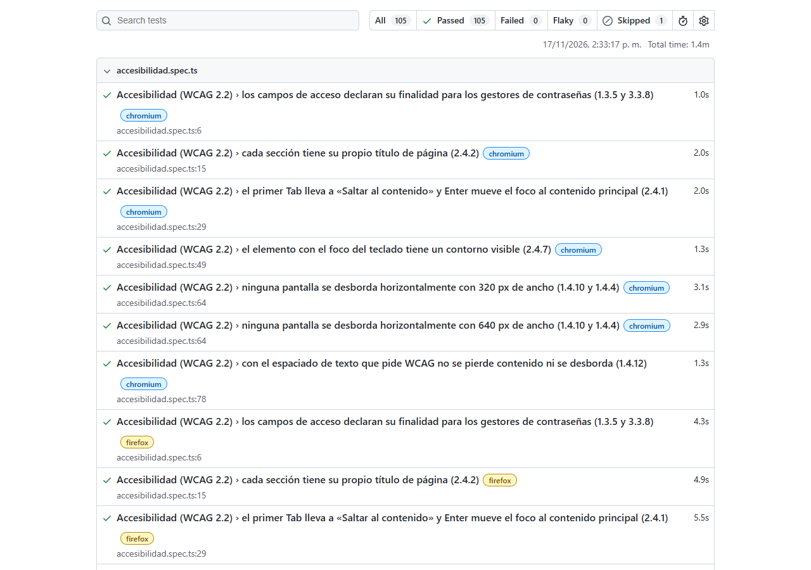

# 03 Análisis de Playwright: pruebas de extremo a extremo y monitoreo

## Metadatos

| Campo | Detalle |
|---|---|
| **Nombre del Proyecto** | RouteZero — Optimizador de rutas sostenibles |
| **Empresa ficticia** | Andina Reparto S.A.C. |
| **Líder del Proyecto** | Inciso Aguilar Elizabeth Antonela |
| **Sprint** | Sprint 4 — Sostenibilidad y Cierre (22-10-2026 – 13-11-2026) |
| **Fecha de las mediciones** | 17-11-2026 (hora de Lima) |
| **Herramienta** | Playwright 1.64.1 (`@playwright/test`) |
| **Versión** | 1.0.0 |

[← Volver al README principal](../../../README.md)

---

## 1. Resumen

La aplicación se prueba de extremo a extremo con Playwright en **tres motores de navegador** (Chromium, Firefox y WebKit), en escritorio y en celular, y se monitorea el sistema desplegado en producción (Vercel y Render).

| Aspecto | Resultado |
|---|---|
| Casos de prueba ejecutados | **106** (30 por navegador de escritorio y 8 por navegador móvil) |
| Resultado | **105 aprobados, 0 fallidos, 0 inestables y 1 omitida** con justificación (sección 3.4) |
| Tasa de éxito de los casos ejecutados | **100 %** (105 de 105) |
| Duración de la suite completa | 1.4 min en local, con ejecución en paralelo |
| TTFB, FCP y LCP de la pantalla de inicio (producción, mediana) | **258 ms, 308 ms y 524 ms**, los tres en el rango «bueno» de Web Vitals |
| Tiempo de respuesta de la API con el servicio despierto (`/api/health`) | mediana **202 ms**, máximo 243 ms en 9 consultas seguidas |
| Códigos HTTP | 200, 401 sin sesión, 404 en ruta inexistente y sin CORS para orígenes ajenos: **todos los esperados** |
| Disponibilidad en la ventana medida | **100 %** (10 de 10 consultas, en cada una de las dos mediciones) |
| Hallazgo principal | El plan gratuito de Render tardó **51.7 s** en la primera petición tras un periodo inactivo (arranque en frío) |



*Figura 1. Informe HTML generado por Playwright el 17-11-2026 (`npx playwright test`, reporter `html`).*

## 2. Configuración del entorno de pruebas

### 2.1 Estructura de carpetas

```text
frontend/
├── playwright.config.ts            suite principal: 5 proyectos (tres navegadores, escritorio y móvil)
├── playwright.monitoreo.config.ts  monitoreo de producción (Web Vitals, API, códigos HTTP)
├── playwright.auditoria.config.ts  auditoría de calidad (Lighthouse y validador W3C)
├── playwright.produccion.config.ts Lighthouse contra Vercel y Render
└── e2e/
    ├── api.ts                      simulación de la API en el navegador y utilidades de sesión
    ├── login.spec.ts               autenticación y permisos por rol
    ├── mapa.spec.ts                mapa de rutas y congestión
    ├── reoptimizacion.spec.ts      re-optimización ante incidentes
    ├── sostenibilidad.spec.ts      dashboard, plan de compensación y reporte PDF
    ├── accesibilidad.spec.ts       criterios de WCAG 2.2
    ├── resiliencia.spec.ts         comportamiento ante fallos de la API
    ├── conductor-movil.spec.ts     vista del conductor en el celular
    ├── operaciones-movil.spec.ts   pantallas de operaciones en el celular
    ├── monitoreo/                  produccion.monitoreo.ts
    └── auditoria/                  Lighthouse, W3C y producción
```

### 2.2 Navegadores y proyectos

| Proyecto | Motor | Dispositivo emulado | Archivos que ejecuta | Casos |
|---|---|---|---|---|
| `chromium` | Chromium | Desktop Chrome | todos menos los de móvil | 30 |
| `firefox` | Firefox | Desktop Firefox | todos menos los de móvil | 30 |
| `webkit` | WebKit (motor de Safari) | Desktop Safari | todos menos los de móvil | 30 |
| `movil-chromium` | Chromium | Pixel 7 | `conductor-movil` y `operaciones-movil` | 8 |
| `movil-webkit` | WebKit | iPhone 14 | `conductor-movil` y `operaciones-movil` | 8 |

Firefox no tiene perfil de dispositivo móvil en Playwright, por eso el móvil se prueba con Chromium y WebKit.

### 2.3 Archivo de configuración

Extracto de [`playwright.config.ts`](../../../frontend/playwright.config.ts):

```ts
export default defineConfig({
  testDir: "./e2e",
  fullyParallel: true,
  forbidOnly: CI,
  retries: CI ? 1 : 0,
  reporter: CI ? [["github"], ["html", { open: "never" }]] : "list",
  use: { baseURL: `http://localhost:${PUERTO}`, locale: "es-PE", timezoneId: "America/Lima", trace: "retain-on-failure" },
  projects: [
    { name: "chromium", testIgnore: /movil\.spec\.ts/, use: { ...devices["Desktop Chrome"], channel: canal } },
    { name: "firefox", testIgnore: /movil\.spec\.ts/, use: { ...devices["Desktop Firefox"] } },
    { name: "webkit", testIgnore: /movil\.spec\.ts/, use: { ...devices["Desktop Safari"] } },
    { name: "movil-chromium", testMatch: /movil\.spec\.ts/, use: { ...devices["Pixel 7"], channel: canal } },
    { name: "movil-webkit", testMatch: /movil\.spec\.ts/, use: { ...devices["iPhone 14"] } },
  ],
  webServer: { command: `npm run build && npx vite preview --port ${PUERTO} --strictPort`, url: `http://localhost:${PUERTO}` },
});
```

- La aplicación se **compila y se sirve** con `vite preview` antes de las pruebas, de modo que se prueba lo que se despliega.
- Zona horaria y configuración regional fijas (`America/Lima`, `es-PE`) para que las horas y los formatos no cambien según el equipo.
- En CI hay un reintento por caso y se bloquea `test.only`; la traza se conserva solo en los casos que fallan.
- En local, Chromium usa el Chrome instalado; en CI, el Chromium que descarga `playwright install`.

### 2.4 Cómo ejecutarlo

| Objetivo | Comando (desde `frontend/`) |
|---|---|
| Instalar los tres navegadores | `npm run e2e:navegador` |
| Suite completa | `npm run test:e2e` |
| Un solo navegador | `npx playwright test --project=firefox` |
| Informe HTML | `npx playwright show-report` |
| Monitoreo de producción | `npm run monitorear` |

### 2.5 Decisión de diseño: API simulada en la suite y monitoreo real aparte

Las pruebas de extremo a extremo **simulan la API en el navegador** (`e2e/api.ts`): así no dependen de Render, de Supabase ni de una cuenta con MFA, son rápidas y repetibles y permiten provocar fallos a voluntad. Cada prueba comprueba además que no haya peticiones sin simular (`expect(api.noSimuladas).toEqual([])`), de modo que un endpoint nuevo o un cambio de contrato que la interfaz ya usa haga fallar la prueba en lugar de pasar inadvertido. Lo que **sí** depende del sistema real (tiempos, disponibilidad, códigos HTTP) se mide aparte, contra producción, con `npm run monitorear` (sección 4).

## 3. Pruebas de extremo a extremo

### 3.1 Casos críticos

| Área | Casos | Qué verifican |
|---|---|---|
| **Autenticación** (`login.spec.ts`, 4) | inicio y cierre de sesión del administrador; credenciales incorrectas; operador sin acceso a flota ni conductores; conductor entra directo a su vista | RN-001 y RN-014: acceso y mínimo privilegio por rol |
| **Flujos de negocio** | mapa con rutas y congestión (5); re-optimización (3); dashboard, plan de compensación y reporte PDF (8) | HU-012 a HU-017: lo que hace cada rol |
| **Vista del conductor en el celular** (`conductor-movil.spec.ts`, 5 por navegador móvil) | ver la ruta, registrar una entrega y pasar a la siguiente parada; ruta completada; sin ruta; cuenta sin vincular; sin desplazamiento horizontal y botones táctiles | HU-014 |
| **Validaciones** | credenciales inválidas muestran «Credenciales inválidas»; el informe sin datos avisa y no descarga nada; el operador no puede re-optimizar | Mensajes y permisos |
| **Accesibilidad** (`accesibilidad.spec.ts`, 7) | finalidad de los campos, título de cada página, enlace «Saltar al contenido», contorno del foco, ausencia de desbordes con 320 y 640 px y con el espaciado de texto de WCAG | WCAG 2.2 |
| **Resiliencia** (`resiliencia.spec.ts`, 3) | red caída al iniciar sesión, error 500 del servidor y ruta del conductor que no carga | Sección 5.2 |

### 3.2 Código relevante

Prueba de autenticación y permisos (`login.spec.ts`):

```ts
test("un administrador inicia sesión, llega al panel y cierra sesión", async ({ page }) => {
  const api = await simularApi(page, { rol: "ADMINISTRADOR" });
  await page.goto("/");
  await page.getByLabel("Correo electrónico").fill(CREDENCIALES.ADMINISTRADOR.email);
  await page.getByLabel("Contraseña").fill(CREDENCIALES.ADMINISTRADOR.password);
  await page.getByRole("button", { name: "Ingresar" }).click();

  await expect(page).toHaveURL(/\/app\/mapa$/);
  const menu = page.getByRole("navigation", { name: "Navegación principal" });
  await expect(menu.getByRole("link", { name: /^Flota/ })).toBeVisible(); // solo el administrador la ve
  ...
  expect(api.noSimuladas).toEqual([]);
});
```

Prueba de validación del reporte PDF sin datos (`sostenibilidad.spec.ts`):

```ts
let descargo = false;
page.on("download", () => (descargo = true));
await page.getByRole("button", { name: "Descargar reporte PDF" }).click();
await expect(page.getByRole("alert").filter({ hasText: "Seleccione otro periodo" })).toBeVisible();
expect(descargo).toBe(false);
```

### 3.3 Resultados de ejecución

Ejecución completa del 17-11-2026 (`npx playwright test`, reporters `html` y `json`):

| Proyecto | Casos | Aprobados | Fallidos | Omitidos |
|---|---|---|---|---|
| `chromium` | 30 | 30 | 0 | 0 |
| `firefox` | 30 | 30 | 0 | 0 |
| `webkit` | 30 | 29 | 0 | 1 |
| `movil-chromium` | 8 | 8 | 0 | 0 |
| `movil-webkit` | 8 | 8 | 0 | 0 |
| **Total** | **106** | **105** | **0** | **1** |

Los 105 casos ejecutados pasaron (100 %), sin ningún caso inestable (`flaky`), en 82 s.

### 3.4 Hallazgo por navegador: WebKit y el tabulador

La prueba «el primer Tab lleva a *Saltar al contenido*» pasa en Chromium y Firefox y **se omite en WebKit**. Al investigarlo, con una sonda que imprimía el elemento enfocado tras cada pulsación, se vio que WebKit solo recorre botones y campos con Tab y **nunca enlaces**, ni el de «Saltar al contenido» ni los del menú. Es el comportamiento por defecto de Safari (los enlaces entran al orden del Tab solo si el usuario activa una preferencia del navegador) y Playwright no puede cambiar esa preferencia. No es un fallo de la aplicación, pero tampoco se puede verificar con teclado en ese motor, por eso la prueba lo declara de forma explícita (`test.skip(browserName === "webkit", …)`) en lugar de ocultarlo.

## 4. Monitoreo de rendimiento en producción

### 4.1 Método

El monitoreo está en [`produccion.monitoreo.ts`](../../../frontend/e2e/monitoreo/produccion.monitoreo.ts) y se ejecuta con `npm run monitorear`. Usa Chromium contra el sistema desplegado (frontend en Vercel y backend en Render), sin credenciales:

- **Web Vitals:** carga la pantalla de inicio de sesión 5 veces, cada una en un contexto nuevo (sin caché). El **LCP** se obtiene con un `PerformanceObserver` registrado antes de que cargue la página; **TTFB** sale de `PerformanceNavigationTiming`, y **FCP** de las entradas de pintura.
- **API:** 10 consultas seguidas a `/api/health` con 3 s de pausa, midiendo el estado y el tiempo de cada una.
- **Clasificación** con los umbrales «bueno» de Web Vitals: TTFB 800 ms o menos, FCP 1.8 s o menos y LCP 2.5 s o menos.

### 4.2 Web Vitals de la pantalla de inicio

| Métrica | Medición 1 (00:33 h, servicio dormido) | Medición 2 (14:35 h, servicio despierto) | Umbral «bueno» |
|---|---|---|---|
| TTFB (mediana) | 348 ms | **258 ms** | ≤ 800 ms |
| FCP (mediana) | 400 ms | **308 ms** | ≤ 1 800 ms |
| LCP (mediana) | 640 ms | **524 ms** | ≤ 2 500 ms |
| DOMContentLoaded (mediana) | 572 ms | 470 ms | — |
| Carga completa (mediana) | 631 ms | 560 ms | — |
| Peor LCP de las 5 cargas | 1 296 ms | 612 ms | ≤ 2 500 ms |

Las cinco cargas de las dos mediciones quedan dentro del umbral «bueno» en las tres métricas. El frontend se sirve desde Vercel (CDN), por eso no se ve afectado por el arranque en frío del backend.

### 4.3 Tiempos de respuesta de la API

| Indicador (`GET /api/health`) | Medición 1 (servicio dormido) | Medición 2 (servicio despierto) |
|---|---|---|
| **Primera petición** | **51 684 ms** | 681 ms |
| Siguientes (mediana, n = 9) | 200 ms | **202 ms** |
| Siguientes (mínimo y máximo) | 178 y 525 ms | 192 y 243 ms |
| Percentil 95 de las siguientes | 525 ms | 243 ms |

### 4.4 Lectura de los resultados

- **Con el servicio despierto, la API cumple el criterio de menos de 500 ms:** 9 de 9 consultas en la medición 2 (máximo 243 ms). En la medición 1 una consulta llegó a 525 ms.
- **La primera petición no lo cumple.** Tras un periodo sin tráfico, Render gratuito apaga el servicio y la primera petición tardó **51.7 s**; en la medición 2, con el servicio ya despierto, la primera tardó 681 ms (incluye abrir la conexión). Se registra como impedimento IMP-027 y se mitiga calentando el servicio antes de cada demostración.
- **`/api/health` no consulta la base de datos.** Los endpoints que sí la consultan tardan más por la latencia de red hacia Supabase: el dashboard de sostenibilidad se midió en 2.4 s, el plan de compensación en 2.3 s y el reporte PDF de un mes en 7.5 s (documentados en [`02 Implementación de la sostenibilidad`](Plan%20y%20documentos%20t%C3%A9cnicos/02%20Implementaci%C3%B3n%20de%20la%20sostenibilidad%20V_1_4_0.md), IMP-016 e IMP-026). El criterio de menos de 500 ms se evalúa aquí sobre el endpoint de salud y las consultas críticas de la base (17 de 17 en 42 ms o menos en el servidor, HT-11).
- **Qué falta:** la medición 1 se hizo con el servicio dormido y su archivo de resultados se sobrescribió con la ejecución siguiente; de ella se conservan las cifras de la tabla, no el archivo. La medición 2 sí se guardó como evidencia.

## 5. Disponibilidad y resiliencia

### 5.1 Códigos de estado HTTP

Comprobados contra producción en la medición 2:

| Petición | Esperado | Obtenido |
|---|---|---|
| `GET /api/health` | 200 | **200** |
| `GET /api/rutas` sin sesión | 401 o 403 | **401** |
| `GET /api/pedidos` sin sesión | 401 o 403 | **401** |
| `GET /api/sostenibilidad/dashboard` sin sesión | 401 o 403 | **401** |
| `GET /api/no-existe` | 404 | **404** |
| `GET /api/health` desde un origen ajeno | sin cabecera CORS que lo permita | **sin cabecera** (CORS restringido) |

Ninguna respuesta fue un error de servidor (5xx): lo protegido se niega con 401 y no con un fallo.

### 5.2 Manejo de errores de red y de servidor

Con la API simulada se provocan los fallos y se comprueba lo que ve la persona. Las tres pruebas pasan en Chromium, Firefox y WebKit:

| Escenario | Comportamiento comprobado |
|---|---|
| La red falla al iniciar sesión (`route.abort`) | Aparece «No se pudo iniciar sesión», no se entra al panel y el botón **Ingresar** vuelve a estar disponible para reintentar |
| El servidor responde **500** al iniciar sesión | Se muestra el mensaje del error («Error interno del servidor») y se puede reintentar |
| La ruta del conductor no carga por un fallo de red | Aparece «No se pudo cargar tu ruta» en lugar de quedarse cargando |

### 5.3 Disponibilidad

En las dos mediciones, **10 de 10 consultas** a `/api/health` respondieron 200: **100 %** de disponibilidad en la ventana medida. Hay que leer ese número con cuidado: cada ventana dura menos de 90 s, así que es una comprobación puntual y no un porcentaje de *uptime* de días o semanas. Para eso haría falta ejecutar el monitoreo de forma periódica; hoy se ejecuta a demanda y **después de cada despliegue** desde el workflow `deploy-production.yml` (sección 6).

## 6. Integración en CI/CD

| Workflow | Papel en las pruebas |
|---|---|
| [`tests.yml`](../../../.github/workflows/tests.yml) | Un trabajo por navegador (Chromium, Firefox y WebKit) con `playwright install --with-deps`, ejecución en modo headless y **informe HTML y trazas guardados como artefactos** aunque las pruebas pasen. También corre Vitest y las pruebas del backend que no usan base de datos |
| [`deploy-production.yml`](../../../.github/workflows/deploy-production.yml) | Después de desplegar, ejecuta `npm run monitorear` contra producción y guarda el resultado como artefacto |
| [`ci.yml`](../../../.github/workflows/ci.yml) | Estilo, compilación, análisis estático y dependencias; es previo a las pruebas |

La ejecución de estos workflows en GitHub Actions se verifica al integrar la rama a `main`; hasta entonces la evidencia es la ejecución local descrita arriba.

## 7. Limitaciones y trabajo futuro

- La suite de extremo a extremo **simula la API**: no detecta fallos del backend real ni de la base. Ese riesgo lo cubren las pruebas de integración del backend (359, contra Supabase), que corren en local y no en GitHub Actions.
- WebKit en Windows y WebKit en Linux (el de GitHub Actions) pueden diferir; las pruebas de este informe se ejecutaron en Windows.
- La disponibilidad se midió en ventanas cortas; un monitoreo periódico (por ejemplo, cada 15 minutos) daría un *uptime* real, a costa de mantener despierto el plan gratuito de Render.
- Firefox no tiene emulación móvil en Playwright, por lo que el móvil solo se prueba en Chromium y WebKit.

## 8. Evidencias

- Informe HTML de la suite completa: [`evidencias/playwright-informe-html.png`](evidencias/playwright-informe-html.png).
- Resultados del monitoreo de producción (medición 2, 17-11-2026): [`evidencias/monitoreo-produccion-2026-11-17.json`](evidencias/monitoreo-produccion-2026-11-17.json).
- Código de las pruebas: [`frontend/e2e/`](../../../frontend/e2e/) y configuración: [`playwright.config.ts`](../../../frontend/playwright.config.ts) y [`playwright.monitoreo.config.ts`](../../../frontend/playwright.monitoreo.config.ts).

---

[← Volver al README principal](../../../README.md)

## Historial de Control de Cambios

| Versión | Fecha | Cambio realizado | Responsable |
|---|---|---|---|
| V_1_0_0 | 2026-11-17 | Versión inicial: configuración de Playwright en tres navegadores, 106 casos de extremo a extremo (105 aprobados y 1 omitido en WebKit), pruebas de resiliencia, monitoreo de producción con Web Vitals, tiempos de la API y códigos HTTP, e integración en los workflows | Inciso Aguilar Elizabeth Antonela |
