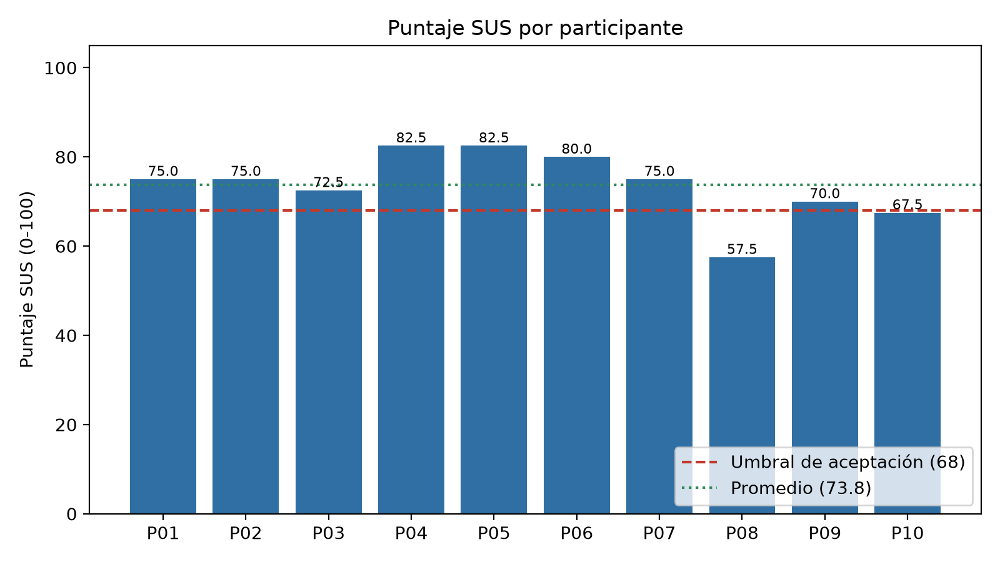
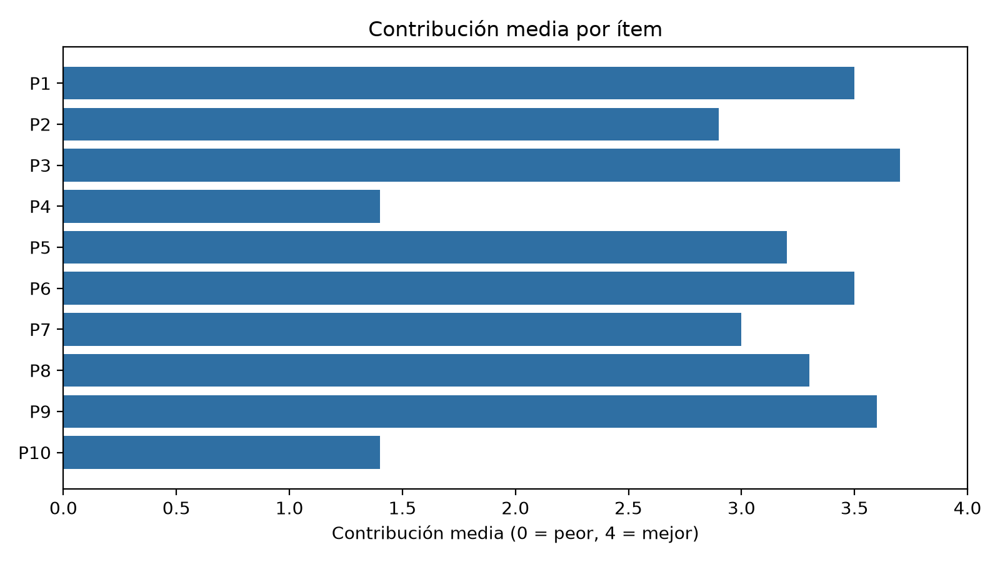

# 04 Evaluación cuantitativa de usabilidad con la escala SUS

## Metadatos

| Campo | Detalle |
|---|---|
| **Nombre del Proyecto** | RouteZero — Optimizador de rutas sostenibles |
| **Empresa ficticia** | Andina Reparto S.A.C. |
| **Líder del Proyecto** | Inciso Aguilar Elizabeth Antonela |
| **Sprint** | Sprint 4 — Sostenibilidad y Cierre (22-10-2026 – 13-11-2026) |
| **Fecha de aplicación** | 17-11-2026 |
| **Instrumento** | System Usability Scale (SUS), 10 ítems, escala Likert de 1 a 5 |
| **Versión** | 1.0.0 |

[← Volver al README principal](../../../README.md)

---

## 1. Resumen

Se aplicó la escala SUS a **10 personas** con experiencia laboral en las áreas de los tres roles del sistema (administración, operación y conducción) después de que usaran RouteZero desplegado en producción.

| Indicador | Resultado |
|---|---|
| Participantes | **10** (3 administración, 3 operación y 4 conducción) |
| Puntaje SUS promedio | **73.8** de 100 (mediana 75; desviación estándar 7.6; rango de 57.5 a 82.5) |
| Umbral de aceptación (68) | **Superado** (+5.8 puntos); 8 de 10 participantes lo alcanzan |
| Grado (Sauro y Lewis, 2016) | **B-** (rango 72.6 a 74.0) |
| Adjetivo (Bangor et al., 2009) | **Bueno** |
| Puntos más débiles | Ítems 4 y 10: necesidad de acompañamiento y de aprender antes de usarlo |
| Principal cuello de botella | **Orientación inicial**: 8 de 10 comentarios dicen que costó entender el funcionamiento sin una explicación previa |

*Figura 1. Puntaje SUS por participante. Solo P08 (57.5) y P10 (67.5) quedan bajo el umbral de 68.*

## 2. Ficha técnica de la evaluación

### 2.1 Instrumento

- **System Usability Scale (SUS)** de Brooke (1996), uno de los cuestionarios estandarizados posteriores al estudio que Sauro y Lewis (2016, cap. 8) revisan: 10 afirmaciones que alternan el sentido positivo (ítems impares) y negativo (ítems pares) y cubren soporte técnico, complejidad, consistencia, aprendizaje y confianza.
- **Escala de valoración:** Likert de 1 a 5 (1 = totalmente en desacuerdo; 5 = totalmente de acuerdo).
- **Enunciados:** traducción al español del material del curso, en el orden original. Las respuestas se recogieron con un formulario de Google Forms que no pide nombre ni correo ni exige iniciar sesión.
- **Puntaje:** impares, respuesta menos 1; pares, 5 menos la respuesta; la suma de las 10 contribuciones se multiplica por 2.5 (rango de 0 a 100).

| Ítem | Enunciado |
|---|---|
| P1 | Creo que me gustaría usar este sistema con regularidad |
| P2 | Encuentro que este sistema es innecesariamente complejo |
| P3 | Considero que el sistema es fácil de usar |
| P4 | Creo que necesitaría ayuda de una persona con experiencia para usar este sistema |
| P5 | Creo que las diversas funciones de este sistema están bien integradas |
| P6 | Creo que hay demasiada inconsistencia en este sistema |
| P7 | Imagino que la mayoría de las personas aprenderían a usar este sistema muy rápidamente |
| P8 | Encuentro que el sistema es muy complicado de usar |
| P9 | Me siento confiado usando este sistema |
| P10 | Necesitaría aprender muchas cosas antes de poder usar este sistema |

### 2.2 Perfil y tamaño de la muestra

**n = 10.** Muestra **por conveniencia, no probabilística**, de personas que trabajan en áreas afines a cada rol del sistema. Por su tamaño y su forma de selección, los resultados describen a este grupo y **no se generalizan** a otros usuarios. No se registró el nombre, el correo ni ningún dato que identifique a los participantes: se identifican con un código (P01 a P10, por orden de respuesta).

| Código | Rol con el que probó | Área de trabajo | Dispositivo | Experiencia previa con sistemas de pedidos, rutas o reparto |
|---|---|---|---|---|
| P01 | Administrador | Administración | Computadora | Poca |
| P02 | Administrador | Administración | Computadora | Media |
| P03 | Administrador | Administración | Celular | Poca |
| P04 | Operador | Operaciones | Computadora | Ninguna |
| P05 | Operador | Operaciones | Celular | Media |
| P06 | Conductor | Transporte | Celular | Ninguna |
| P07 | Operador | Operaciones | Celular | Media |
| P08 | Conductor | Transporte | Celular | Ninguna |
| P09 | Conductor | Transporte | Celular | Ninguna |
| P10 | Conductor | Transporte | Celular | Media |

Resumen del perfil: 3 administradores, 3 operadores y 4 conductores; 7 usaron el celular y 3 la computadora; 4 sin experiencia previa, 2 con poca y 4 con experiencia media.

### 2.3 Procedimiento y tareas ejecutadas antes de responder

Sesiones individuales de 10 a 34 minutos, sobre el sistema desplegado (frontend en Vercel y backend en Render), siguiendo la [guía de la sesión](../../../scripts/usabilidad/GUION_SESION.md). Cada participante realizó las tareas de su rol **sin ayuda**. El formulario SUS se compartió con un enlace y cada persona lo respondió **por su cuenta**, cuando tuvo tiempo, el mismo día de la sesión (las respuestas llegaron entre las 2:36 y las 8:24 p. m.). Brooke recomienda responder inmediatamente después de usar el sistema; aquí varias respuestas se dieron algunas horas después (ver limitaciones).

| Rol | Tareas | Criterio de éxito |
|---|---|---|
| Administrador | A1: ir a Sostenibilidad. A2: elegir el mes anterior y descargar el reporte en PDF. A3: ir a Rutas, generar las rutas del día y descartar el borrador | Llega a la pantalla; el PDF se descarga o entiende el aviso de que no hay datos; genera y descarta el borrador |
| Operador | O1: registrar un pedido para un cliente de la lista. O2: encontrarlo en la lista. O3: cancelarlo | El pedido se registra, se localiza y queda cancelado |
| Conductor (celular) | C1: indicar la siguiente parada y su cliente. C2: registrar la entrega con «Entregado». C3: indicar cuántas entregas lleva | Identifica la parada, registra la entrega y lee el contador |

**Duración de cada sesión** (tareas más encuesta), anotada por quien dirigió las pruebas:

| Rol | Duraciones (min) | Promedio | Mediana |
|---|---|---|---|
| Administrador | 18, 25, 24 | 22.3 | 24 |
| Operador | 30, 28, 34 | 30.7 | 30 |
| Conductor | 14, 10, 17, 12 | 13.3 | 13 |
| **Todos** | | **21.2** | |

No se midieron tiempos por tarea, por lo que no se reporta una tasa de éxito por tarea.

## 3. Resultados cuantitativos

### 3.1 Respuestas brutas por participante

| Participante | P1 | P2 | P3 | P4 | P5 | P6 | P7 | P8 | P9 | P10 |
|---|---|---|---|---|---|---|---|---|---|---|
| P01 | 5 | 2 | 4 | 3 | 4 | 1 | 3 | 2 | 5 | 3 |
| P02 | 4 | 2 | 5 | 4 | 4 | 1 | 4 | 1 | 5 | 4 |
| P03 | 5 | 4 | 5 | 3 | 4 | 2 | 4 | 1 | 5 | 4 |
| P04 | 4 | 2 | 5 | 3 | 5 | 1 | 5 | 1 | 5 | 4 |
| P05 | 5 | 1 | 5 | 4 | 5 | 1 | 3 | 1 | 5 | 3 |
| P06 | 4 | 2 | 4 | 3 | 4 | 2 | 5 | 1 | 5 | 2 |
| P07 | 5 | 2 | 5 | 4 | 5 | 1 | 4 | 2 | 4 | 4 |
| P08 | 4 | 2 | 5 | 5 | 3 | 2 | 4 | 4 | 4 | 4 |
| P09 | 4 | 2 | 5 | 3 | 4 | 2 | 4 | 2 | 4 | 4 |
| P10 | 5 | 2 | 4 | 4 | 4 | 2 | 4 | 2 | 4 | 4 |

### 3.2 Cálculo paso a paso del puntaje individual

**Ejemplo con P01.** Respuestas: 5, 2, 4, 3, 4, 1, 3, 2, 5, 3.

| Ítem | Respuesta | Regla | Contribución |
|---|---|---|---|
| P1 (impar) | 5 | 5 − 1 | 4 |
| P2 (par) | 2 | 5 − 2 | 3 |
| P3 (impar) | 4 | 4 − 1 | 3 |
| P4 (par) | 3 | 5 − 3 | 2 |
| P5 (impar) | 4 | 4 − 1 | 3 |
| P6 (par) | 1 | 5 − 1 | 4 |
| P7 (impar) | 3 | 3 − 1 | 2 |
| P8 (par) | 2 | 5 − 2 | 3 |
| P9 (impar) | 5 | 5 − 1 | 4 |
| P10 (par) | 3 | 5 − 3 | 2 |
| **Suma** | | | **30** |

Puntaje de P01 = 30 × 2.5 = **75**. El mismo cálculo para los 10 participantes:

| Participante | P1 | P2 | P3 | P4 | P5 | P6 | P7 | P8 | P9 | P10 | Suma | Puntaje (× 2.5) |
|---|---|---|---|---|---|---|---|---|---|---|---|---|
| P01 | 4 | 3 | 3 | 2 | 3 | 4 | 2 | 3 | 4 | 2 | 30 | 75 |
| P02 | 3 | 3 | 4 | 1 | 3 | 4 | 3 | 4 | 4 | 1 | 30 | 75 |
| P03 | 4 | 1 | 4 | 2 | 3 | 3 | 3 | 4 | 4 | 1 | 29 | 72.5 |
| P04 | 3 | 3 | 4 | 2 | 4 | 4 | 4 | 4 | 4 | 1 | 33 | 82.5 |
| P05 | 4 | 4 | 4 | 1 | 4 | 4 | 2 | 4 | 4 | 2 | 33 | 82.5 |
| P06 | 3 | 3 | 3 | 2 | 3 | 3 | 4 | 4 | 4 | 3 | 32 | 80 |
| P07 | 4 | 3 | 4 | 1 | 4 | 4 | 3 | 3 | 3 | 1 | 30 | 75 |
| P08 | 3 | 3 | 4 | 0 | 2 | 3 | 3 | 1 | 3 | 1 | 23 | 57.5 |
| P09 | 3 | 3 | 4 | 2 | 3 | 3 | 3 | 3 | 3 | 1 | 28 | 70 |
| P10 | 4 | 3 | 3 | 1 | 3 | 3 | 3 | 3 | 3 | 1 | 27 | 67.5 |

### 3.3 Puntaje SUS promedio global

(75 + 75 + 72.5 + 82.5 + 82.5 + 80 + 75 + 57.5 + 70 + 67.5) / 10 = 737.5 / 10 = **73.75 ≈ 73.8**

| Estadístico | Valor |
|---|---|
| Promedio | 73.8 |
| Mediana | 75 |
| Desviación estándar | 7.6 |
| Mínimo y máximo | 57.5 (P08) y 82.5 (P04 y P05) |

## 4. Análisis e interpretación

### 4.1 Frente al estándar de la industria

- **El promedio (73.8) supera el umbral de aceptación de 68** por 5.8 puntos. Ocho de los diez participantes lo alcanzan; los dos que no lo hacen son P08 (57.5) y P10 (67.5, a medio punto).
- **Grado B-** en la escala de calificación por letras de Sauro y Lewis (2016), cuyo rango para esa nota es de 72.6 a 74.0 y que corresponde a los percentiles 65 a 69 de su base de referencia: el sistema se percibe más usable que alrededor de dos de cada tres sistemas evaluados. Es el promedio de un grupo pequeño, así que conviene leerlo como una **señal, no como una medida precisa**.
- **Adjetivo «bueno»** según la escala adjetival de Bangor et al. (2009), que asocia «bueno» con puntajes de alrededor de 71, «regular» con alrededor de 51 y «excelente» con más de 85: el promedio (73.8) queda por encima de «bueno» y lejos de «excelente».
- **Referencia de la industria:** el puntaje medio de la base de Sauro y Lewis es 68 (percentil 50), de modo que 73.8 está por encima del promedio.

### 4.2 Por ítem

Brooke advierte que el puntaje de un ítem suelto no es significativo por sí solo; aquí se usa solo para orientar dónde mirar.

*Figura 2. Contribución media por ítem (0 = peor, 4 = mejor).*

| Ítem | Contribución media | Lectura |
|---|---|---|
| P3 Es fácil de usar | **3.70** | El punto más fuerte |
| P9 Me siento confiado usándolo | 3.60 | Confianza alta |
| P1 Me gustaría usarlo con regularidad | 3.50 | Interés de uso |
| P6 Hay demasiada inconsistencia | 3.50 | La interfaz se percibe consistente |
| P8 Es muy complicado de usar | 3.30 | No se percibe complicado |
| P5 Las funciones están bien integradas | 3.20 | Buena integración |
| P7 La mayoría aprendería rápido | 3.00 | Aprendizaje razonable |
| P2 Es innecesariamente complejo | 2.90 | |
| **P4 Necesitaría ayuda de una persona con experiencia** | **1.40** | **Punto débil** (respuesta media de 3.6: tienden a estar de acuerdo con necesitar ayuda) |
| **P10 Necesitaría aprender muchas cosas antes** | **1.40** | **Punto débil** (respuesta media de 3.6) |

El sistema se percibe fácil, consistente y confiable (**P3, P9, P1, P6**), pero la gente siente que **necesita una explicación o acompañamiento antes de empezar** (**P4 y P10**).

### 4.3 Por rol, dispositivo y experiencia previa

| Grupo | n | Promedio SUS | Grado equivalente |
|---|---|---|---|
| Operador | 3 | **80.0** | A- |
| Administrador | 3 | 74.2 | B |
| Conductor | 4 | **68.8** | C |
| Computadora | 3 | 77.5 | B+ |
| Celular | 7 | 72.1 | C+ |
| Experiencia media | 4 | 75.0 | B |
| Experiencia poca | 2 | 73.8 | B- |
| Sin experiencia | 4 | 72.5 | C+ |

Con grupos de 2 a 7 personas no se aplicó ninguna prueba estadística: las diferencias son **indicativas**. Aun así sugieren dos cosas: los **conductores** (que usan el celular y que, en su mayoría, nunca habían usado un sistema parecido) son el grupo con menor puntaje y quedan apenas por encima del umbral, y la experiencia previa baja el puntaje solo unos 2.5 puntos. El puntaje más bajo (P08, 57.5) es de un conductor sin experiencia previa que marcó que necesitaría ayuda (P4 = 5), que el sistema es complicado (P8 = 4) y que debe aprender mucho antes (P10 = 4).

### 4.4 Cuellos de botella de la interfaz (comentarios abiertos)

Además de las 10 afirmaciones, el formulario preguntó qué costó o confundió más y qué cambiarían. Los comentarios confirman lo que muestran P4 y P10:

| # | Cuello de botella | Evidencia | Participantes |
|---|---|---|---|
| 1 | **Orientación inicial:** costó entender el funcionamiento o hizo falta una explicación previa | 8 de 10 comentarios; varios lo dicen sin molestia («ya con la explicación se entiende mejor»), pero coinciden con P4 y P10 | P01, P02, P03, P04, P05, P07, P08, P09 |
| 2 | **Mapa y rutas:** interpretar los elementos del mapa, los estados de las rutas y la generación de rutas | 3 de 10 | P01, P05, P06 |
| 3 | **Pantalla de inicio:** el panel de indicadores (dashboard) no es lo primero que se ve, porque se abre el mapa | 1 de 10 | P02 |
| 4 | **Paso de seguridad:** el código de verificación en dos pasos del inicio de sesión necesitó explicación | 1 de 10 | P03 |
| 5 | **Gestión de conductores y de vehículos:** no era claro qué datos se registran de cada uno | 1 de 10 | P07 |

Lo positivo que señalan: el mapa («está bien elaborado»), la lista de entregas junto al mapa, la centralización de la información y que la interfaz resulta novedosa para quienes hoy trabajan de forma manual.

### 4.5 Mejoras sugeridas por los usuarios y propuestas

Lo que pidieron los participantes: sección de preguntas y respuestas (P03), notificación de la siguiente parada (P06), historial de entregas (P08), observaciones en cada entrega, por ejemplo cuando el cliente no estaba (P09 y P10), fotos del conductor y del vehículo (P07), cobro de cada servicio (P05) y una estética acorde con la empresa que lo adopte (P01). Dos participantes (P02 y P04) no cambiarían nada. Se contrastó con lo que ya existe en la interfaz (el mapa tiene leyenda de estados de entrega, el login explica el código de 6 dígitos y las entregas ya admiten «No se pudo», pero sin nota libre ni historial).

Mejoras **propuestas**, ordenadas por impacto sobre los puntos débiles (P4 y P10):

| Prioridad | Mejora propuesta | Responde a | Esfuerzo |
|---|---|---|---|
| 1 | **Guía de primeros pasos y preguntas frecuentes** dentro del sistema, con un recorrido corto por rol | Cuello de botella 1; P4 y P10; pedido de P03 | Bajo |
| 2 | **Ampliar la leyenda del mapa** para incluir los estados de las rutas y explicar cómo se generan y confirman | Cuello de botella 2 | Bajo |
| 3 | **Explicar la verificación en dos pasos** la primera vez (por qué se pide y cómo obtener el código) | Cuello de botella 4 | Bajo |
| 4 | **Nota opcional en cada entrega** (por ejemplo, «el cliente no estaba») | P09, P10 | Medio: requiere un campo nuevo en la base de datos y en la API |
| 5 | **Historial de entregas del conductor** | P08 | Medio |
| 6 | **Fotos del conductor y del vehículo** (ya está pendiente con Cloudinary) | P07 | Medio |
| 7 | Notificación de la siguiente parada; cobro por servicio; identidad visual de la empresa | P06, P05, P01 | Alto o fuera del alcance de este proyecto |

**Verificación de las mejoras:** repetir la escala SUS con el mismo instrumento y el mismo tipo de participantes. Meta: promedio igual o mayor a 73.8, **sin ningún participante bajo 68** y una contribución media de los ítems P4 y P10 de al menos 2.0 (hoy 1.4). Hasta el cierre de este informe no se aplicó ninguna de estas mejoras.

## 5. Conclusiones

- RouteZero **supera el umbral de aceptación** de la escala SUS (73.8 frente a 68; grado B-; «bueno»), con 8 de 10 participantes por encima del umbral y sin diferencias grandes entre roles.
- Se percibe **fácil de usar, consistente y confiable**, incluso por personas sin experiencia previa en sistemas de gestión y que hoy trabajan de forma manual.
- La principal debilidad es la **curva de entrada**: los participantes sienten que necesitan una explicación antes de empezar (P4 y P10). La mejora de mayor impacto y menor costo es una guía de primeros pasos con preguntas frecuentes.
- Los **conductores**, que usan el sistema en el celular, son el grupo con el puntaje más bajo y el más cercano al umbral; conviene priorizar su recorrido.

## 6. Limitaciones

- **Muestra pequeña y por conveniencia** (n = 10, no probabilística): los resultados no son generalizables ni se probaron con pruebas estadísticas.
- La SUS mide la **percepción global**; no mide por sí sola si las tareas se completaron ni cuánto tardaron. No se registraron tiempos por tarea.
- Los enunciados en español son la traducción del material del curso; no se hizo una validación formal de esa traducción.
- Las duraciones de las sesiones incluyen el tiempo de la encuesta.
- **Momento de la respuesta:** la escala se respondió por cuenta de cada participante algunas horas después de usar el sistema, no inmediatamente, como recomienda Brooke; el recuerdo de la experiencia pudo ser menos preciso.
- Los grados de letra y el adjetivo son referencias de la literatura calculadas sobre muestras mucho mayores; con n = 10 conviene leerlos como orientación.

## 7. Evidencias

- Formulario de la encuesta (Google Apps Script que lo crea): [`crear_formulario_sus.gs`](../../../scripts/usabilidad/crear_formulario_sus.gs).
- Guía de las sesiones y tareas por rol: [`GUION_SESION.md`](../../../scripts/usabilidad/GUION_SESION.md).
- Cálculo del puntaje: [`procesar_sus.py`](../../../scripts/usabilidad/procesar_sus.py) y sus pruebas, [`test_procesar_sus.py`](../../../scripts/usabilidad/test_procesar_sus.py) (incluyen el ejemplo resuelto del artículo original de Brooke).
- Gráficos: [`evidencias/sus-por-participante.png`](evidencias/sus-por-participante.png) y [`evidencias/sus-por-item.png`](evidencias/sus-por-item.png).
- Las respuestas originales (archivo CSV de Google Forms) no se publican en el repositorio para proteger a los participantes.

## 8. Referencias

Bangor, A., Kortum, P. T., & Miller, J. T. (2009). Determining what individual SUS scores mean: Adding an adjective rating scale. *Journal of Usability Studies, 4*(3), 114–123.

Brooke, J. (1996). SUS: A quick and dirty usability scale. En P. W. Jordan, B. Thomas, B. A. Weerdmeester, & I. L. McClelland (Eds.), *Usability evaluation in industry* (pp. 189–194). Taylor & Francis.

Sauro, J., & Lewis, J. R. (2016). *Quantifying the user experience: Practical statistics for user research* (2.ª ed.). Morgan Kaufmann.

---

[← Volver al README principal](../../../README.md)

## Historial de Control de Cambios

| Versión | Fecha | Cambio realizado | Responsable |
|---|---|---|---|
| V_1_0_0 | 2026-11-17 | Versión inicial: ficha técnica, respuestas de 10 participantes, cálculo paso a paso del puntaje SUS (73.8; grado B-), análisis por ítem, rol, dispositivo y experiencia, cuellos de botella, mejoras propuestas y limitaciones | Inciso Aguilar Elizabeth Antonela |
| V_1_0_0 (ajuste) | 2026-11-17 | Se precisa cómo se recogieron las respuestas (por cuenta de cada participante, algunas horas después de usar el sistema) y se agrega la limitación correspondiente | Inciso Aguilar Elizabeth Antonela |
| V_1_0_0 (ajuste) | 2026-11-17 | Se precisan la referencia de la industria y la correspondencia del adjetivo «bueno», ya verificadas con la tabla de los autores | Inciso Aguilar Elizabeth Antonela |
