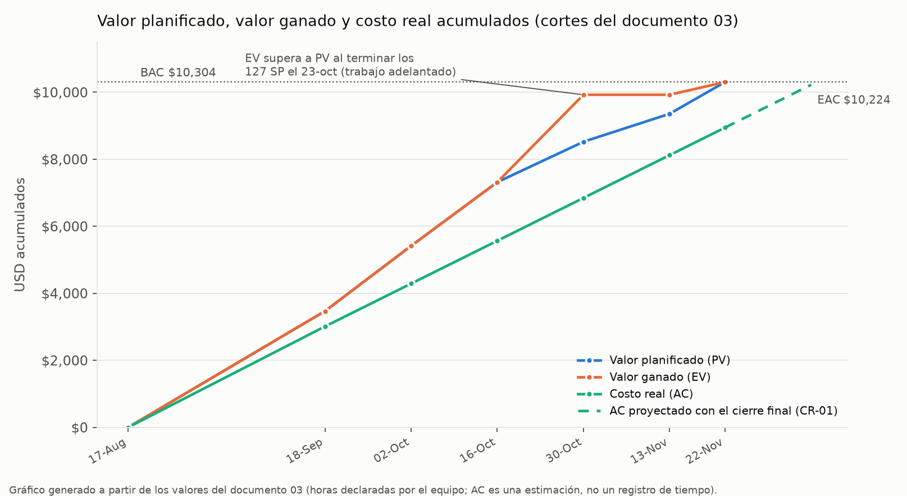
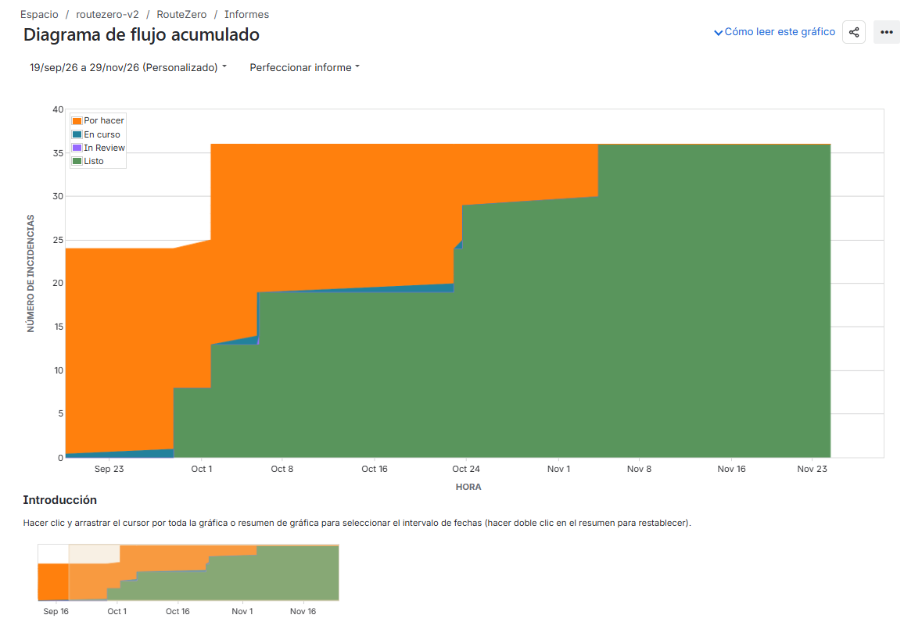
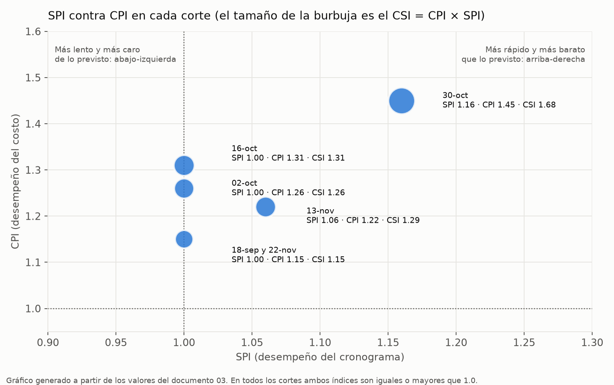
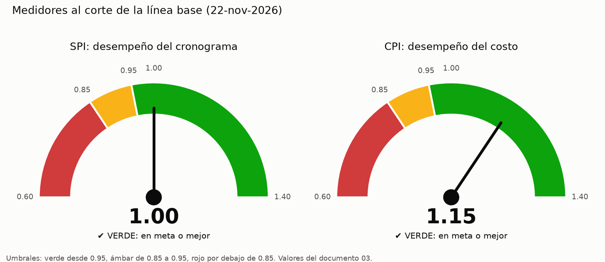
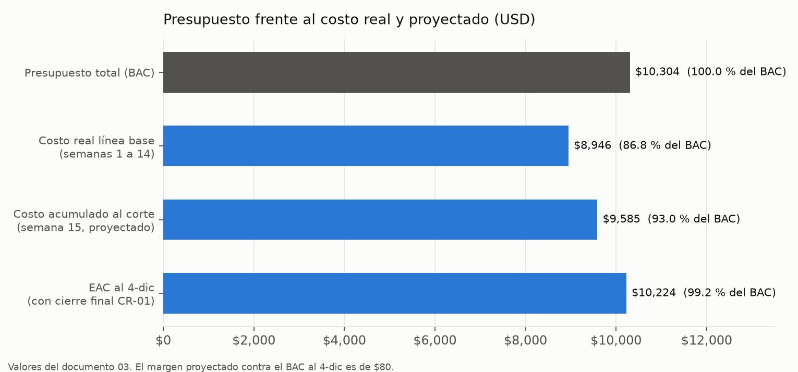

# 04 Tableros de Control Híbridos (Hybrid Dashboards)

[← Volver al README Principal](../../README.md)

## Metadatos

| Campo | Detalle |
|---|---|
| **Proyecto** | RouteZero — Optimizador de rutas sostenibles |
| **Líder del Proyecto** | Inciso Aguilar Elizabeth Antonela |
| **Integrantes** | Inciso Aguilar Elizabeth Antonela, Espinoza Tiza Yago Imanol, Guerra Lozano Keen, Uscuvilca Ramos Abraham Luis |
| **Frecuencia de Actualización** | **Predictivo** (costo, cronograma y EVM): en cada corte de sprint (02-10, 16-10, 30-10 y 13-11) y al cierre de la línea base (22-11), y el 30-11 en el cierre final. **Adaptativo** (Story Points, flujo): Jira, actualizado al cerrar cada sprint |
| **Fecha de Corte** | 2026-11-30 |
| **Fecha de elaboración** | 2026-11-24 |
| **Versión** | 1.0.0 |

---

Este tablero reúne en una sola vista el desempeño **predictivo** (planificación, costo, cronograma y cierre, medidos con valor ganado) y el **adaptativo** (cuatro sprints con Story Points en Jira). Los valores salen del [`03 Reporte de Análisis de Valor Ganado - EVM`](03%20Reporte%20de%20An%C3%A1lisis%20de%20Valor%20Ganado%20-%20EVM%20V_1_0_0.md) y de los gráficos de Jira; el análisis de los radiadores ágiles está en [`05 Radiadores de Información`](05%20Radiadores%20de%20Informaci%C3%B3n%20V_1_0_0.md).

## 1. Justificación de Métricas (Principio Less is More)

- **Necesidades de los interesados.**
  - **El docente evaluador**, que representa a la patrocinadora, necesita saber en una mirada si se cumplió el alcance, si el costo está dentro del presupuesto y qué queda abierto.
  - **El equipo** necesita ver el ritmo de entrega, los cuellos de botella y la tendencia del costo para tomar decisiones en el cierre.
  - Por eso hay un solo tablero con pocos indicadores, y el detalle se consulta en los reportes 01, 02 y 03.
- **Criterios de selección de KPIs.** Se eligieron los indicadores que responden una pregunta de decisión, y se descartaron los que repetían información.

| KPI | Pregunta que responde | Origen |
|---|---|---|
| SPI y SV | ¿Vamos a tiempo? | EVM (03) |
| CPI y CV | ¿Estamos dentro del presupuesto? | EVM (03) |
| EAC frente al BAC | ¿En cuánto terminará el proyecto? | EVM (03) |
| Story Points aceptados frente a planificados | ¿Se entregó el alcance de cada sprint? | Jira (05) |
| Flujo de incidencias por estado | ¿Hay cuellos de botella? | Jira (diagrama de flujo acumulado) |
| Semáforo por componente | ¿Dónde está el problema? | Este tablero |

Quedaron fuera, a propósito, las métricas técnicas finas (por ejemplo cada tiempo de consulta o cada resultado de Lighthouse), que están en los documentos de cada sprint y se resumen en el semáforo de calidad.

**Umbrales del semáforo.** 🟢 Verde: SPI y CPI desde 0.95 y sin brechas abiertas. 🟡 Ámbar: SPI o CPI de 0.85 a 0.95, o brechas abiertas con plan de acción. 🔴 Rojo: índice menor que 0.85, o un problema crítico sin respuesta.

## 2. Tabla Semáforo (RAG Chart) por Componente

| Componente / Entregable | Enfoque (Predictivo/Adaptativo) | Estado (🟢 Verde / 🟡 Ámbar / 🔴 Rojo) | Observación / Umbral |
|---|---|---|---|
| Inicio y planificación (acta, requisitos, presupuesto, riesgos) | Predictivo | 🟢 Verde | Completo al 18-09; documentos versionados |
| Sprint 1: autenticación, flota y pedidos | Adaptativo | 🟢 Verde | 42 de 42 SP; cierre el 01-10, un día antes de lo planificado. El alcance de Jira creció de 20 a 42 SP el 01-10 |
| Sprint 2: personas y motor ACO | Adaptativo | 🟢 Verde | 41 de 41 SP en Jira; HT-07 verificada por completo el 20-10 |
| Sprint 3: re-optimización y mapa | Adaptativo | 🟢 Verde | 26 de 26 SP; cierre el 22-10, 8 días antes |
| Sprint 4: sostenibilidad | Adaptativo | 🟢 Verde | 18 de 18 SP el 23-10; cierre el 29-10, 15 días antes |
| Cronograma de la línea base | Predictivo | 🟢 Verde | SPI 1.00 y SV $0.00 al 22-11 |
| Costo de la línea base | Predictivo | 🟢 Verde | CPI 1.15 y CV +$1,358.00 |
| Tendencia del costo | Predictivo | 🟡 Ámbar | El CPI acumulado baja de 1.31 (16-10) a 1.15 (22-11) y el del último periodo es 0.88 |
| Costo con el cierre final (CR-01) | Predictivo | 🟡 Ámbar | EAC $10,224.00 contra BAC $10,304.00: margen de $80 (0.8 %) |
| Calidad y validación (SonarQube, OWASP, WCAG, Playwright, SUS) | Adaptativo | 🟡 Ámbar | Quality Gate aprobado y 0 vulnerabilidades, pero 4 de 40 criterios de WCAG y brechas manuales de OWASP abiertos |
| Rendimiento en infraestructura gratuita (Render) | Adaptativo | 🟡 Ámbar | Rutas en 29.1 s (límite 45 s) y re-optimización en 22.2 a 27.1 s (límite 30 s), pero arranque en frío de 51.7 s (IMP-027) |
| Proceso de revisión de código (aprobación de Pull Request) | Adaptativo | 🟡 Ámbar | Aprobación de un compañero solo en el #60 y el #64; acción de retrospectiva abierta |
| Cierre final: reportes, video y sustentación (CR-01) | Predictivo | 🟡 Ámbar | En elaboración en las semanas 15 y 16; sustentación el 04-12 |

**Lectura.** Ninguna fila está en rojo. Todo lo que se planificó está entregado (verde) y los puntos ámbar son controles de calidad abiertos y el margen del cierre final, cada uno con su plan de acción en los reportes 02 y 07.

## 3. Gráficos de Desempeño Predictivo y Ágil

### 3.1 Tendencias de Variación y Valor Ganado (Líneas)

*Figura 1. Valor planificado (PV), valor ganado (EV) y costo real (AC) acumulados en los cortes del documento 03, con la proyección del costo hasta el 04-12. Gráfico generado a partir de los valores del documento 03.*

**Interpretación.** El EV acompaña al PV hasta el 16-10 y lo supera desde el 30-10, cuando los 127 SP ya estaban aceptados (23-10) y el PV aún esperaba el cierre planificado de los sprints. Las dos líneas se juntan en $10,304 el 22-11, al terminar la línea base. El AC va **siempre por debajo** del EV (CPI mayor que 1), pero su pendiente es constante mientras el EV ya terminó: por eso el margen se reduce en las últimas semanas y la proyección con el cierre final llega a $10,224.

### 3.2 Flujo Acumulado / Áreas Apiladas

*Figura 2. Diagrama de flujo acumulado de Jira, del 19-09 al 29-11-2026 (captura real).*

**Interpretación.**
- **Se terminó en cinco escalones**, que coinciden con los cierres de sprint: unos 8 ítems el 28-09 (Sprint 1), 13 el 01-10, 19 el 06-10 (Sprint 2), 24 y 29 el 22 y 23-10 (Sprints 3 y 4) y 36 hacia el 05-11. Esa cifra de 36 coincide con los 29 ítems del backlog más las 7 épicas.
- **La banda «En curso» es casi invisible y «In Review» no se aprecia en ningún momento.** Es la huella de la actualización del tablero en bloque: las incidencias pasaban de «Por hacer» a «Listo» directamente al cerrar el sprint. Por eso **no se observan cuellos de botella en el flujo**, aunque tampoco se puede medir el tiempo de ciclo de cada historia.
- **El total de incidencias sube de unas 24 a 36 entre fines de septiembre y comienzos de octubre** y desde entonces permanece constante: en el resto del proyecto no se agregaron incidencias nuevas.
- **Mejora:** mover cada historia por «En curso» y «In Review» durante el sprint permitiría medir el tiempo de ciclo y detectar cuellos de botella, como indica el capítulo de informes.

### 3.3 Relación Costo-Cronograma (SPI vs. CPI con tamaño CSI)

*Figura 3. SPI contra CPI en cada corte; el tamaño de la burbuja es el CSI (CPI × SPI). Gráfico generado a partir de los valores del documento 03.*

**Interpretación.** Todos los cortes están en o sobre 1.0 en ambos ejes, es decir, en la zona favorable (más rápido y más barato de lo previsto). La burbuja más grande es la del 30-10 (SPI 1.16, CPI 1.45, CSI 1.68), cuando el trabajo ya estaba entregado y casi no se había gastado en proporción. A partir de ahí la trayectoria se mueve hacia abajo (CPI 1.22 el 13-11 y 1.15 el 22-11), que es la tendencia a vigilar.

### 3.4 Medidores de Estado (Gauges) / Gráficos de Barras

*Figura 4. Medidores de SPI y CPI al corte de la línea base (22-11-2026). Gráfico generado a partir de los valores del documento 03.*

*Figura 5. Presupuesto frente al costo real y proyectado (USD). Gráfico generado a partir de los valores del documento 03.*

**Interpretación.** Los dos medidores están en verde: SPI 1.00 (todo lo planificado está entregado) y CPI 1.15 (más trabajo por dólar de lo presupuestado). Las barras muestran que la línea base gastó el 86.8 % del BAC y que, con el cierre final, el costo proyectado llega al 99.2 %: dentro del presupuesto, pero con un margen de solo $80.

---

[← Volver al README Principal](../../README.md)

## Historial de Control de Cambios

| Versión | Fecha | Cambio realizado | Responsable |
|---|---|---|---|
| V_1_0_0 | 2026-11-24 | Versión inicial: tablero híbrido con semáforo por componente, justificación de métricas, diagrama de flujo acumulado de Jira y gráficos de valor ganado | Inciso Aguilar Elizabeth Antonela |
