# 05 Radiadores de Información (Information Radiators)

[← Volver al README Principal](../../README.md)

## Metadatos

| Campo | Detalle |
|---|---|
| **Proyecto** | RouteZero — Optimizador de rutas sostenibles |
| **Líder del Proyecto** | Inciso Aguilar Elizabeth Antonela |
| **Integrantes** | Inciso Aguilar Elizabeth Antonela, Espinoza Tiza Yago Imanol, Guerra Lozano Keen, Uscuvilca Ramos Abraham Luis |
| **Marco Ágil Utilizado** | Scrum con cuatro sprints de dos semanas, gestionados en Jira (planificación, revisión y retrospectiva de cada sprint) |
| **Fecha de las capturas** | 2026-11-24, tomadas de Jira y de la retrospectiva del Sprint 4 |
| **Versión** | 1.0.0 |

---

Las imágenes de este documento son **capturas reales** de Jira y de GitHub. Los valores acumulados de estos radiadores se integran con los indicadores de costo y cronograma en [`04 Tableros de Control - Híbridos`](04%20Tableros%20de%20Control%20-%20H%C3%ADbridos%20V_1_0_0.md). Una característica común a todos los gráficos de Jira, explicada en el análisis: **el equipo terminaba el trabajo en el repositorio y marcaba las historias como terminadas todas a la vez al cerrar cada sprint**, por lo que la línea de trabajo terminado sube en escalón y no refleja el ritmo real del día a día.

## 1. Burndown Chart (Trabajo Restante)

En Jira se llama «Gráfica de trabajo pendiente». La línea gris es la guía de avance ideal y la roja son los Story Points restantes.

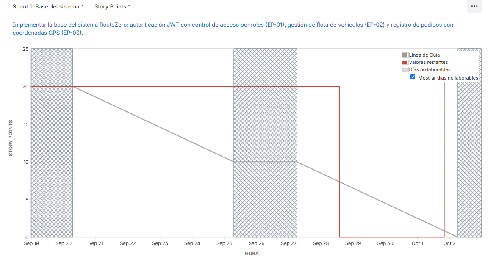

*Figura 1. Burndown del Sprint 1: Base del sistema (19-09 al 02-10-2026).*

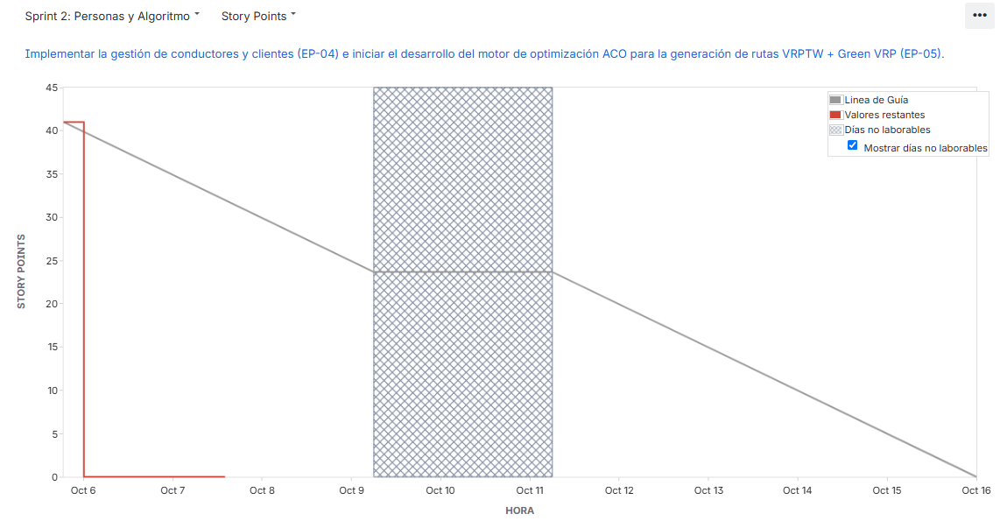

*Figura 2. Burndown del Sprint 2: Personas y Algoritmo (05-10 al 16-10-2026, finalizado el 07-10).*

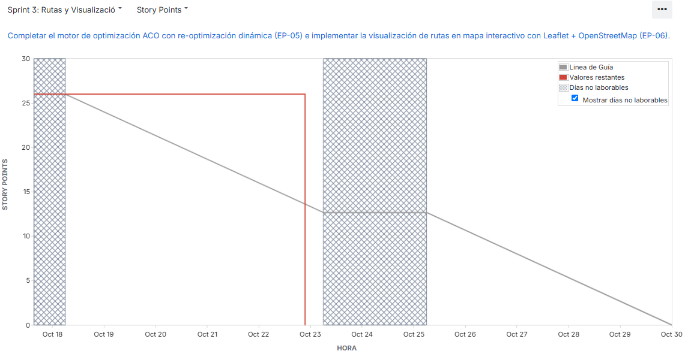

*Figura 3. Burndown del Sprint 3: Rutas y Visualización (17-10 al 30-10-2026, finalizado el 22-10).*

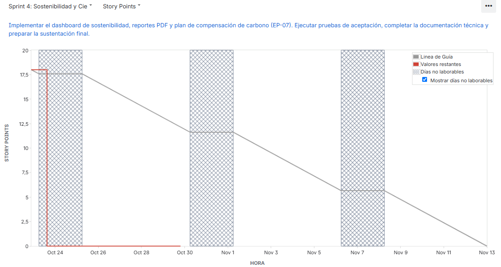

*Figura 4. Burndown del Sprint 4: Sostenibilidad y Cierre (22-10 al 13-11-2026, finalizado el 29-10).*

**Análisis de velocidad y tasa de finalización.**

| Sprint | Alcance (SP) | Restante pasa a cero | Cierre en Jira | Fin planificado | Cierre anticipado |
|---|---|---|---|---|---|
| 1 | 20 (sube a 42 el 01-10) | 28-09 (historias de usuario) y 01-10 (historias técnicas) | 01-10 | 02-10 | 1 día |
| 2 | 41 | 06-10 | 07-10 | 16-10 | 9 días |
| 3 | 26 | 22-10 | 22-10 | 30-10 | 8 días |
| 4 | 18 | 23-10 | 29-10 | 13-11 | 15 días |

- **Los cuatro sprints se completaron al 100 % de su alcance** y la línea de restante queda **por debajo de la guía** desde el momento en que cae a cero. Eso significa que se terminó antes del ritmo ideal y no que se retrasó.
- **La velocidad promedio fue de unos 32 Story Points por sprint** (127 SP en cuatro sprints: 42, 41, 26 y 18). El promedio baja en los últimos sprints porque el alcance planificado de cada uno fue menor (26 y 18 SP), y todos se completaron.
- **La forma de escalón** (línea plana y caída vertical) se debe a la actualización de estados en bloque al cerrar el sprint. La evidencia del avance real durante cada sprint está en el historial de git y en los planes de ejecución de cada sprint en `docs/03 Implementación`.
- **Limitación en el Sprint 1.** La escala del eje termina en 25 Story Points: el salto de alcance a 42 del 01-10 queda fuera del gráfico, y se aprecia mejor en el burnup.

## 2. Burnup Chart (Trabajo Completado y Cambios de Alcance)

En Jira se llama «Gráfica de trabajo hecho». La línea roja es el alcance, la verde el trabajo terminado y la gris la guía.

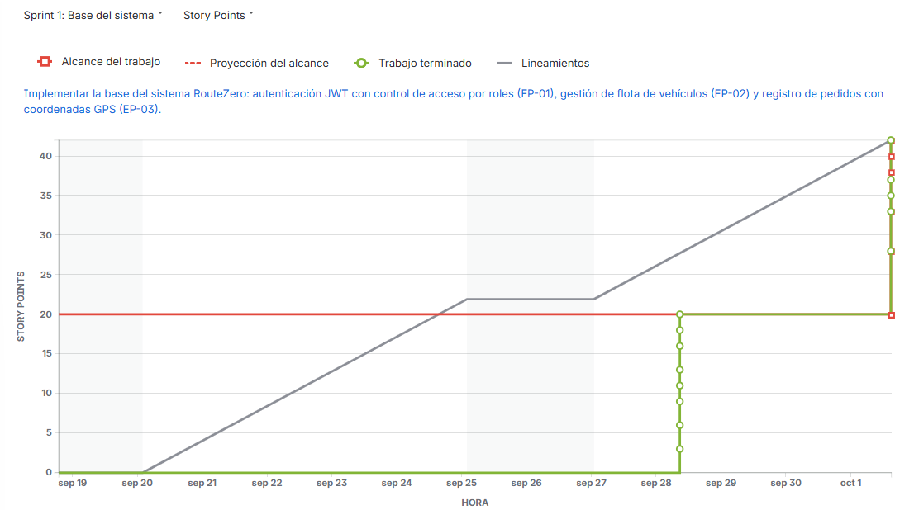

*Figura 5. Burnup del Sprint 1: el alcance sube de 20 a 42 SP el 01-10 y el trabajo terminado llega a 42.*

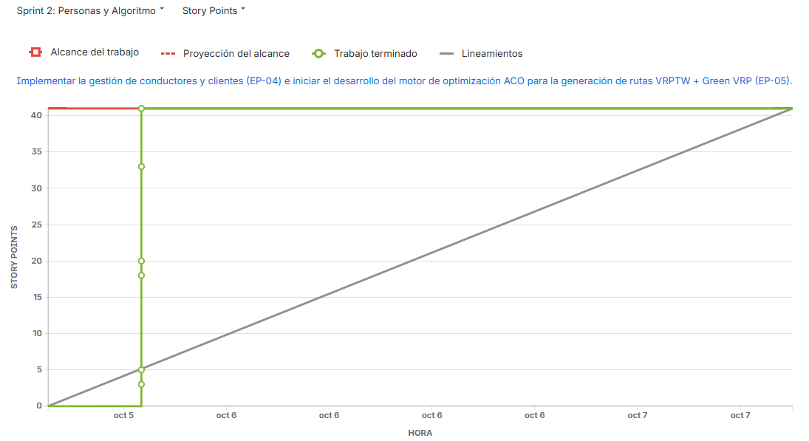

*Figura 6. Burnup del Sprint 2: alcance constante de 41 SP.*

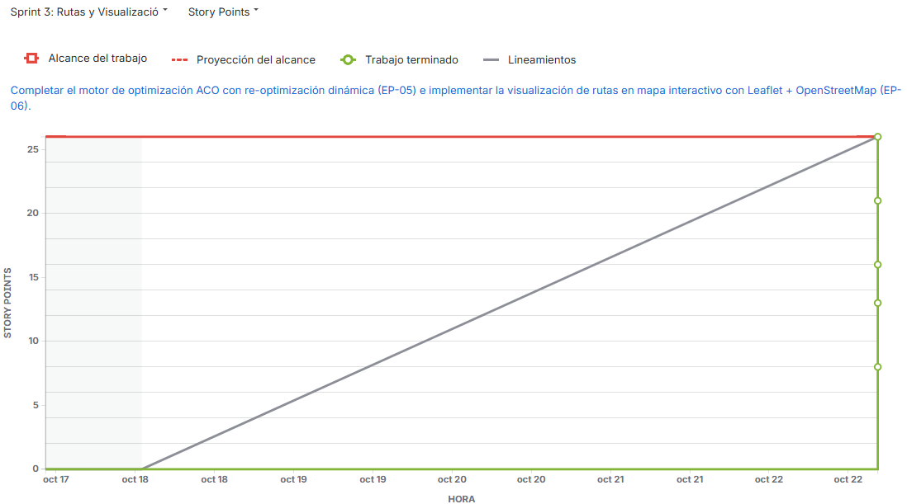

*Figura 7. Burnup del Sprint 3: alcance constante de 26 SP.*

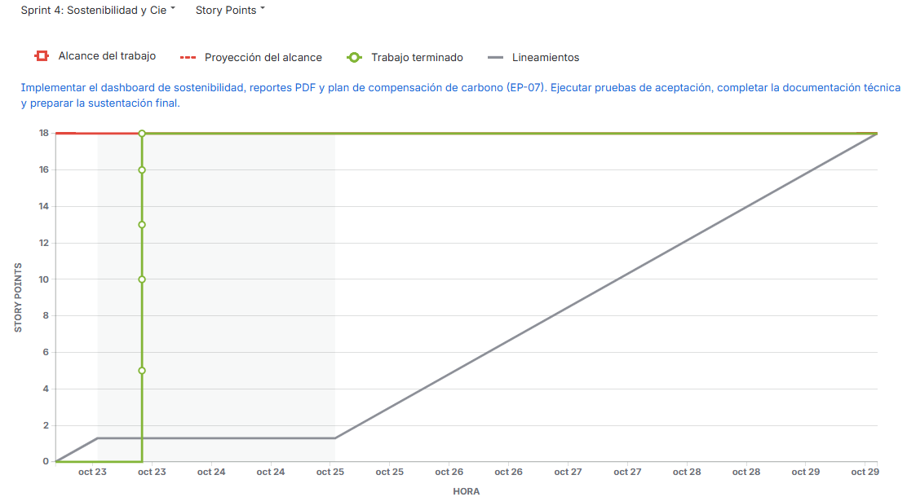

*Figura 8. Burnup del Sprint 4: alcance constante de 18 SP.*

**Análisis de crecimiento de alcance frente a trabajo aceptado.**

| Sprint | Alcance inicial | Alcance final | Cambio de alcance | Trabajo aceptado |
|---|---|---|---|---|
| 1 | 20 SP | 42 SP | **+22 SP (+110 %)** | 42 SP (100 %) |
| 2 | 41 SP | 41 SP | 0 | 41 SP (100 %) |
| 3 | 26 SP | 26 SP | 0 | 26 SP (100 %) |
| 4 | 18 SP | 18 SP | 0 | 18 SP (100 %) |

- **El alcance fue estable en los Sprints 2, 3 y 4**: la línea roja es plana, sin corrupción de alcance (*scope creep*).
- **El único cambio de alcance está en el Sprint 1.** Las cinco historias técnicas HT-01 a HT-05 (22 SP) se agregaron al sprint el 01-10 y se terminaron ese mismo día, por lo que el trabajo terminado sube de 20 a 42 SP al final. El plan de ejecución del sprint las incluye desde el inicio (42 SP y 13 ítems), de modo que respecto a la línea base aprobada no hay variación de alcance; la diferencia es de cuándo se cargaron en Jira. En el cálculo de valor ganado ([`03`](03%20Reporte%20de%20An%C3%A1lisis%20de%20Valor%20Ganado%20-%20EVM%20V_1_0_0.md)) se mide contra los 42 SP.
- **Lección:** cargar en Jira todo el alcance comprometido desde el inicio del sprint, para que el burnup muestre el avance sobre el alcance real (ver [`07`](07%20Reporte%20Final%20de%20Lecciones%20Aprendidas%20V_1_0_0.md)).

## 3. Task Board / Tablero Kanban

Los sprints están cerrados, así que la vista «Sprints activos» de Jira ya no muestra tarjetas. El estado final del tablero se muestra con la **vista Lista** del proyecto, donde cada historia aparece con su estado y su responsable.

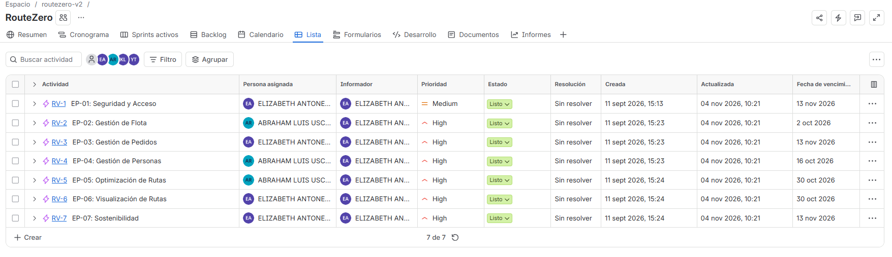

*Figura 9. Las siete épicas del proyecto, todas en «Listo» (captura real de Jira).*

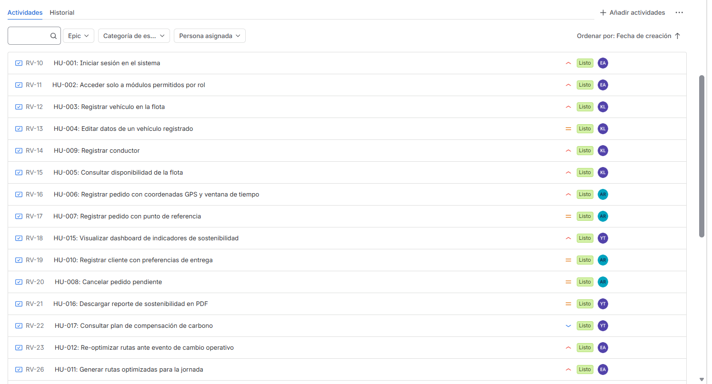

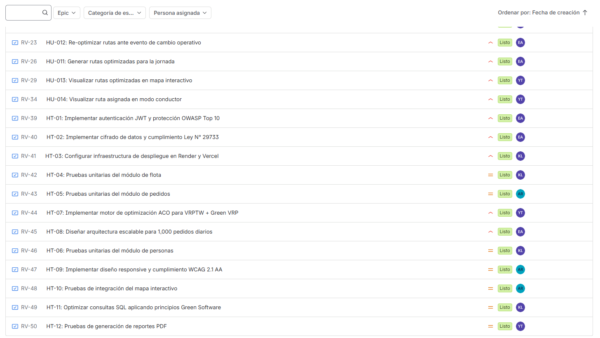

*Figuras 10 y 11. Las 29 historias de usuario e historias técnicas, todas en «Listo», con su responsable (captura real de Jira).*

**Análisis de flujo y cuellos de botella identificados.**

- **Estado final:** 7 épicas y 29 historias en «Listo». Las épicas se cerraron juntas el 04-11-2026, lo que explica el último escalón del diagrama de flujo acumulado ([`04`](04%20Tableros%20de%20Control%20-%20H%C3%ADbridos%20V_1_0_0.md), figura 2).
- **Flujo:** las historias pasaron de «Por hacer» a «Listo» casi sin detenerse en «En curso» y sin usar «In Review». Por eso **no se observan cuellos de botella en el tablero**, pero tampoco se puede medir el tiempo de ciclo de cada historia. La revisión de código se hizo por Pull Request en GitHub, fuera de Jira.
- **Mejora:** usar «En curso» y «In Review» durante el sprint, y mover las tarjetas a diario, permitiría ver el flujo real y detectar cuellos de botella.

## 4. Mood Chart (Estado de Ánimo del Equipo)

Escala: 😞 Muy mal · 🙁 Mal · 😐 Regular · 🙂 Bien · 😄 Muy bien.

| Integrante / Rol | Sprint 1 | Sprint 2 | Sprint 3 | Sprint Final (Sprint 4) |
|---|---|---|---|---|
| Inciso Aguilar Elizabeth Antonela (Arquitecta de Software / Project Manager) | 😄 | 😄 | 😄 | 😄 |
| Espinoza Tiza Yago Imanol (Ingeniero de IA e Integración) | 🙂–😄 | 🙂–😄 | 🙂–😄 | 🙂–😄 |
| Guerra Lozano Keen (Desarrollador Backend) | 😄 | 😄 | 😄 | 😄 |
| Uscuvilca Ramos Abraham Luis (Desarrollador Frontend) | 🙂 | 🙂 | 🙂 | 🙂 |

Cada integrante declaró por escrito un mismo estado de ánimo para los cuatro sprints. El símbolo 🙂–😄 indica «entre bien y muy bien».

**Interpretación del clima laboral.** El equipo se mantuvo entre bien y muy bien durante todo el proyecto. No hubo caídas de ánimo entre sprints, aunque la exigencia de entregar bien en cada uno fue alta y el equipo la manejó, cumpliendo el alcance de los cuatro sprints. El clima positivo coincide con lo que se aprecia en los radiadores: sprints completados antes de lo planificado y sin cambios de alcance salvo el del Sprint 1.

## 5. Tableros de Retrospectiva

El equipo documentó cada retrospectiva con la estructura de lo que funcionó, lo que se puede mejorar y las acciones. Se muestra la del último sprint (Sprint 4, presentada en la Inspección 05); las de los demás sprints están en la carpeta de cada uno en `docs/03 Implementación`.

- **Evidencia (fuente):** [`02 Retrospectiva del Sprint V_1_0_0`](../03%20Implementaci%C3%B3n/Sprint%204/02%20Retrospectiva%20del%20Sprint%20V_1_0_0.md) del Sprint 4.

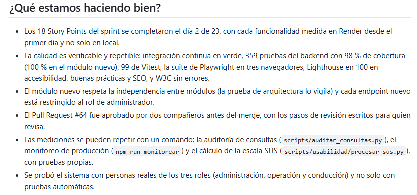

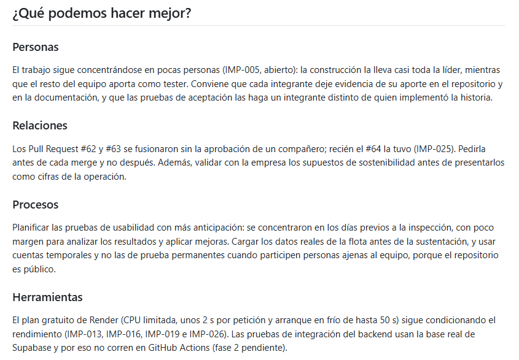

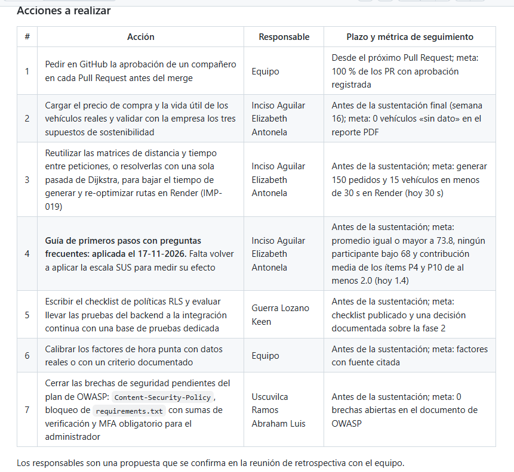

*Figuras 12 a 14. Retrospectiva del Sprint 4: lo que funcionó bien, oportunidades de mejora y acciones (capturas de GitHub).*

- **Lo que funcionó bien:** los 18 Story Points se completaron el día 2 de 23, con cada funcionalidad medida en Render; calidad verificable y repetible (integración continua en verde, 359 pruebas del backend con 98 % de cobertura, Playwright en tres navegadores, Lighthouse y W3C); mediciones repetibles con un comando; el Pull Request #64 aprobado por dos compañeros; pruebas con personas reales de los tres roles.
- **Oportunidades de mejora:** *Personas:* el trabajo se concentra en pocas personas (IMP-005). *Relaciones:* aprobación de un compañero antes de cada merge, y validar los supuestos de sostenibilidad con la empresa. *Procesos:* planificar la usabilidad con más anticipación y cargar los datos reales de la flota. *Herramientas:* el plan gratuito de Render condiciona el rendimiento.
- **Acciones implementadas durante el proyecto:** la guía de primeros pasos con preguntas frecuentes (acción 4, aplicada el 17-11-2026) y la aprobación de un compañero en los Pull Request #60 y #64 (acción 1). El resto de las mejoras de la tabla son opcionales y quedan para una siguiente etapa; están resumidas en [`06 Reporte Final del Proyecto`](06%20Reporte%20Final%20del%20Proyecto%20V_1_0_0.md).

---

[← Volver al README Principal](../../README.md)

## Historial de Control de Cambios

| Versión | Fecha | Cambio realizado | Responsable |
|---|---|---|---|
| V_1_0_0 | 2026-11-24 | Versión inicial: burndown y burnup de los cuatro sprints, estado final del tablero, mood chart y retrospectiva del Sprint 4, con capturas reales de Jira y GitHub | Inciso Aguilar Elizabeth Antonela |
